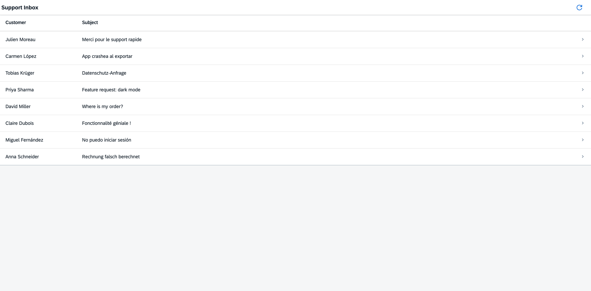

# Setup — Clone the starter + run the base app (AI-assistant track)

**Time:** 5 minutes. **Ends with:** the base UI5 list/detail app running against the
starter's data service. **No AI yet — and nothing to prompt for.**

## Goal

Get the base app running so Exercises 1–5 are pure **AI wiring**, driven by your assistant.

The starter already contains a complete, runnable UI5 app plus the data service and all
tooling. There's nothing to generate in this exercise — you clone, install, run, and confirm
the assistant can see the project.

## Clone the starter

```bash
cd ~/dev
git clone https://github.com/SAP-samples/ui5con-2026-chrome-built-in-ai ui5con-2026-chrome-built-in-ai
cd ui5con-2026-chrome-built-in-ai
git checkout starter      # base UI5 app + data service + tooling
npm install
npm start
```

Open `http://localhost:8080` — you should see the **Support Inbox** with 8 tickets.

## What's in the starter

- A **base UI5 app** in `webapp/` (list + detail, freestyle TypeScript) with a shared `ai`
  JSONModel already wired in `Component.ts`.
- A black-box **OData V4 data service** on `/ticket` (a CAP app — you never touch it).
- All **tooling**, including `.mcp.json` (UI5 MCP) and `CLAUDE.md` (house conventions).

## Point your assistant at it

Open the project folder in your assistant and confirm UI5 MCP is connected (see Setup: MCP setup).
Verify it can see the project:

```text
Using UI5 MCP, confirm the framework version from webapp/ui5.yaml, then list the files
under webapp/ and summarize what List.controller.ts and Detail.controller.ts currently do.
```

A working setup reports **SAPUI5 1.140.0**, lists the views/controllers, and notes the
controllers currently just navigate and refresh — no AI yet. If it can't see the files,
re-check that you opened the cloned folder (not a parent directory).

> From Exercise 1 on you'll prompt the assistant to edit `webapp/`. It should **never** touch
> the data service (`db/`, `srv/`) or the tooling — those are the granted starter.

## Verify

- [ ] `http://localhost:8080` → **Support Inbox** with 8 rows (Anna … Julien)
- [ ] Columns: Customer, Subject; clicking a row opens the Detail body
- [ ] The data service answers: `curl -s "http://localhost:4004/ticket/Tickets?\$top=1"` returns JSON
- [ ] Your assistant can list the `webapp/` files via UI5 MCP

---

## What you should see



*(Screenshots captured in `?mock=1` mode.)*

---

Ready? → [Exercise 1: UI scaffold + the `ai.ts` seam](03-ui-scaffold.md)
