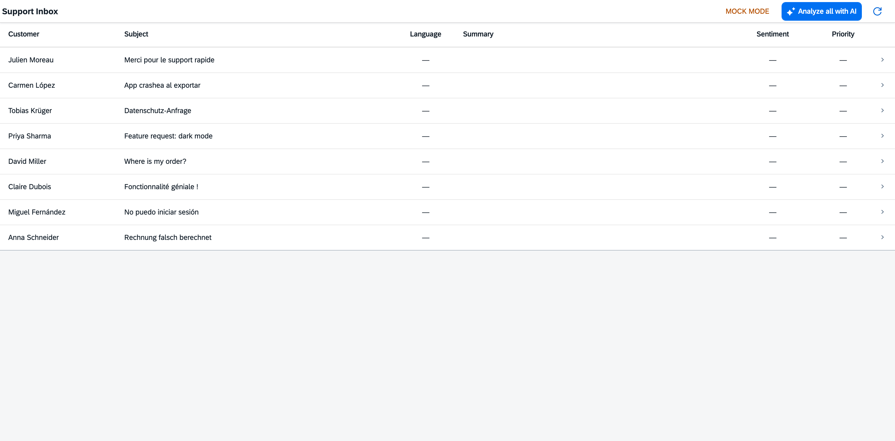

# Exercise 1 — UI scaffold + the `ai.ts` seam (AI-assistant track)

**Time:** 10 minutes. **Ends with:** four AI columns (all `—`), three detail actions that
toast "not wired yet", and the **complete `ai.ts` shim** with a `?mock=1` mock.

**Answer key:** [`docs/manual/03-ui-scaffold.md`](../manual/03-ui-scaffold.md) shows the two
new files in full and each changed file as a diff (with the full file in a collapsed section).

## The key idea to hold the assistant to

**`ai.ts` ships complete in this exercise.** Controllers never touch `Summarizer` /
`Translator` / `LanguageDetector` / `LanguageModel` / `Writer` directly — they call
`ai.summarize()`, `ai.translate()`, `ai.classify()`, `ai.draftReply()`. That single seam is
also where `?mock=1` swaps the whole implementation. Don't let the assistant "simplify" by
inlining Chrome API calls into controllers, and don't let it defer parts of `ai.ts` to later
exercises — it's all implemented now, wired to controllers later.

## Prompt 1 — the seam

```text
Add the AI seam for this app as two files under webapp/model/:

webapp/model/ai.ts — a class RealAI with these async methods, each feature-detecting the
Chrome global and creating+caching a session with a monitor(downloadprogress) callback
that calls an optional hooks.onProgress(loaded):
  - status(): probe Summarizer, LanguageDetector, LanguageModel availability, and
    Translator.availability({sourceLanguage:'de', targetLanguage:'en'}); return a map.
  - summarize(text, hooks?): Summarizer.create({type:'tldr', length:'short',
    format:'plain-text'}), cache it, return summarize(text).
  - detectLanguage(text, hooks?): LanguageDetector, filter out 'und' and confidence <= 0.4.
  - translate(text, src, tgt, hooks?): return text if src===tgt; cache a Translator per
    `${src}:${tgt}` pair.
  - classify(body, hooks?): LanguageModel.create with a system prompt for support-ticket
    triage and expectedInputs [{type:'text', languages:['en']}]; prompt(body,
    {responseConstraint: CLASSIFICATION_SCHEMA}); JSON.parse the result. Define
    CLASSIFICATION_SCHEMA (object; required sentiment/category/priority; enums
    positive|neutral|negative, billing|technical|account|shipping|other, low|medium|high;
    additionalProperties false).
  - draftReply(body, agentIntent, hooks?): try Writer.create (tone 'formal', length
    'medium', format 'plain-text', sharedContext with the ticket body) then writer.write;
    else fall back to LanguageModel.create + prompt; else throw.
Export types Availability, LanguageDetection, TicketClassification, AiHooks. End the file:
  const useMock = new URLSearchParams(location.search).has('mock');
  export const ai = useMock ? mockAI : new RealAI();
Import { mockAI } from './ai.mock'.

webapp/model/ai.mock.ts — export const mockAI with the same method signatures, returning
deterministic canned output based on regex-matching the ticket body (guess language,
sentiment, category, priority; fake a short summary; translate() returns a
`[MOCK src→tgt] …` prefix). Import types only from './ai'.

Type the Chrome globals via @types/dom-chromium-ai (already a devDependency). Then run
mcp__ui5__run_ui5_linter with fix:true.
```

## Prompt 2 — the UI + controller stubs

```text
Now wire the UI scaffold (do NOT wire real AI yet — handlers just toast "not wired yet"):

1. List.view.xml: add 4 AI columns (Language, Summary, Sentiment, Priority) to the table
   plus a header ObjectStatus showing MOCK MODE (yellow) when ai>/mock else ai>/summarizer,
   an "Analyze all with AI" Button (press .onAnalyzeAll, disabled while ai>/busy), and keep
   the refresh button. Bind AI cells to the OData fields for now
   ({detectedLanguage} etc. → shows '—' since seed data is empty). Add
   detectedLanguage,summary,sentiment,category,priority to the table's $select.
2. Detail.view.xml: add three title actions (Translate toggle, Analyze, Draft reply), a
   DynamicPageHeader with 4 status chips (Language/Sentiment/Category/Priority bound to the
   OData fields), and content panels: AI summary, Original message (title toggles to
   English translation via detail>/showingTranslation), and a Drafted reply panel with a
   TextArea, visible only when detail>/draftedReply is set.
3. List.controller.ts: onInit calls _probeAiStatus() which awaits ai.status() and writes
   summarizer/translator/languageDetector/languageModel into the ai model. onAnalyzeAll
   toasts "not wired yet".
4. Detail.controller.ts: add a view-local `detail` JSONModel {showingTranslation:false,
   translatedBody:"", draftedReply:""}; reset it in the route-matched handler and extend
   the $select to include the AI fields. Stub onToggleTranslation / onAnalyze /
   onDraftReply with "not wired yet" toasts.

Use UI5 MCP get_api_reference for ObjectStatus, ProgressIndicator, DynamicPageHeader,
TextArea before emitting them. Then run mcp__ui5__run_ui5_linter with fix:true.
```

## Diff against the answer key

Compare `webapp/model/ai.ts`, `webapp/model/ai.mock.ts`, both views, and both controllers
against [`docs/manual/03-ui-scaffold.md`](../manual/03-ui-scaffold.md). Structural must-haves:

- `ai.ts` ends with the `useMock ? mockAI : new RealAI()` export
- `ai.mock.ts` imports **types only** from `./ai` (no runtime cycle)
- Controllers import `{ ai }` from `../model/ai` and call **only** `ai.*` — never a Chrome
  global directly
- The AI cells bind to OData fields at this stage (formatters come in Exercise 2)

## Verify

Reload (`?mock=1` if policy-blocked):

- [ ] 6 columns; AI columns show `—`
- [ ] Header shows an availability chip or `MOCK MODE`
- [ ] Detail page: 4 chips (all `—`) + 3 action buttons
- [ ] Any AI button toasts "not wired yet"

---

## What you should see



*(Screenshots captured in `?mock=1` mode.)*

---

Ready? → [Exercise 2: Summarizer + LanguageDetector](04-summarizer.md)
