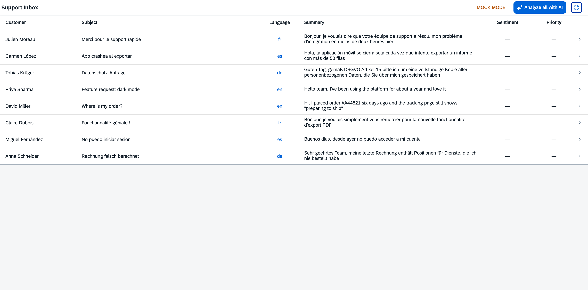

# Exercise 2 — Summarizer + LanguageDetector (AI-assistant track)

**Time:** 10 minutes. **Ends with:** **Analyze all with AI** fills each row's language chip
and summary; the detail **Analyze** button does the same for one ticket.

**Answer key:** [`docs/manual/04-summarizer.md`](../manual/04-summarizer.md) shows all five
changed files as diffs, each with the full file in a collapsed section.

## The prompt

```text
Wire the first two Chrome AI calls into the controllers. Do NOT edit ai.ts — summarize()
and detectLanguage() are already implemented there. Five files change:

1. Component.ts: add `results: {}` to the ai JSONModel (comment: results[ticketId] =
   {language, summary, sentiment, category, priority}) and call
   oAiModel.setSizeLimit(1000) before setModel.

2. List.controller.ts: implement onAnalyzeAll — loop the table's items; for each row with a
   body and no cached summary yet, run ai.detectLanguage(body) and ai.summarize(body)
   concurrently with Promise.all (each with its own .catch fallback), take langs[0]?.
   detectedLanguage ?? 'und', and store {language, summary} via a private _setResult helper.
   _setResult copies the outer /results object, merges results[id], and reassigns it (so
   bindings refresh). Toggle ai>/busy around the loop. Add public formatter methods
   fmtLanguage, fmtSummary, fmtSentiment, fmtSentimentState, fmtPriority, fmtPriorityState
   that read from the results map keyed by id.

3. Detail.controller.ts: implement onAnalyze the same way for the single bound ticket
   (Promise.all of detect + summarize, store language + summary in ai>/results). Add
   formatters fmtLanguage, fmtSummaryOrHint (hint text when no summary), fmtSentiment,
   fmtSentimentState, fmtCategory, fmtPriority, fmtPriorityState.

4. List.view.xml: rebind the 4 AI cells from OData fields to formatters, e.g.
   text="{parts:[{path:'ID'},{path:'ai>/results'}], formatter:'.fmtLanguage'}".

5. Detail.view.xml: rebind the header chips and the summary panel to the same formatter
   pattern (fmtSummaryOrHint for the summary panel).

Formatter methods must be public. After changes run mcp__ui5__run_ui5_linter with fix:true.
```

## Concepts to confirm the assistant got right

- **`Promise.all`** runs detect + summarize concurrently (they're independent).
- **Per-call `.catch`** so one ticket's failure doesn't abort the batch.
- **`_setResult` reassigns `/results`** with a new object reference — mutating in place
  wouldn't fire a binding refresh. If the assistant mutates `results[id]` and calls
  `setProperty` on the same reference, rows won't update; point it at the manual exercise.
- **`parts:[{path:'ID'},{path:'ai>/results'}]`** feeds `(id, results)` into the formatter.

## Diff against the answer key

Compare against [`docs/manual/04-summarizer.md`](../manual/04-summarizer.md). Common
assistant slips to catch:

- Forgetting `setSizeLimit(1000)` → large results maps silently truncate
- Binding formatters to `{ai>/results}` without the `ID` part → formatter gets no key
- Making formatters `private` → binding can't resolve `.fmtX`

## Verify

- [ ] **Analyze all with AI** → rows get a language code + summary line
- [ ] `?mock=1` shows DE / ES / FR / EN correctly
- [ ] Sentiment / Priority still `—` (Exercise 4)
- [ ] Detail **Analyze** fills the Language chip + Summary panel
- [ ] Navigate back → results survive (Component-scoped `ai` model)

```js
sap.ui.getCore().getComponent(sap.ui.getCore().getComponents()[0]).getModel("ai").getProperty("/results")
```

---

## What you should see



*(Screenshots captured in `?mock=1` mode.)*

---

Ready? → [Exercise 3: Translator](05-translator.md)
