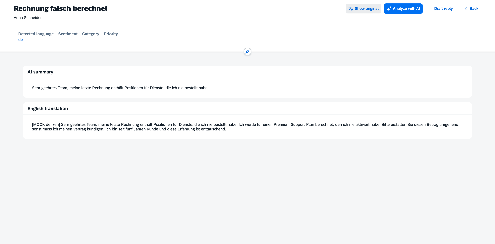

# Exercise 3 — Translator, English-pivot (AI-assistant track)

**Time:** 5 minutes. **Ends with:** **Translate** on the Detail page translates a
non-English ticket to English; clicking again toggles back.

**Answer key:** [`docs/manual/05-translator.md`](../manual/05-translator.md) shows the
`Detail.controller.ts` change as a diff, with the full file in a collapsed section.

## The prompt

```text
Wire the Translator API to the Detail page's toggle button. Only Detail.controller.ts
changes — ai.translate() is already implemented in ai.ts. Rewrite onToggleTranslation with
three branches:
  1. If detail>/showingTranslation is true → set it false and return (no API call).
  2. Else if detail>/translatedBody already set → set showingTranslation true and return.
  3. Else: read the ticket body + ID; reuse ai>/results[id].language if present and not
     'und', otherwise ai.detectLanguage(body); if the language is 'en' toast "Already in
     English" and return; else ai.translate(body, lang, 'en'), store in
     detail>/translatedBody, set showingTranslation true.
Toggle ai>/busy around the API work and catch errors into a MessageToast. Keep onAnalyze
and all formatters unchanged. Then run mcp__ui5__run_ui5_linter with fix:true.
```

## Concepts to confirm

- **English pivot:** the Translator only supports pairs through English (`de↔en`, `es↔en`),
  not `de↔fr`. This exercise only ever goes `X→en`, so it's fine; Exercise 5 goes `en→X`.
- **Availability needs a pair:** `Translator.availability()` with no args throws — that's why
  `ai.status()` probes with `{sourceLanguage:'de', targetLanguage:'en'}`.
- **Reusing the detected language** from `ai>/results` avoids a redundant detect call.

## Diff against the answer key

Compare `Detail.controller.ts` against
[`docs/manual/05-translator.md`](../manual/05-translator.md). The only change from Exercise 2
is `onToggleTranslation`'s body; everything else is identical.

## Verify

Open a non-English ticket (Anna / Julien):

- [ ] **Translate to English** → panel shows the English translation, title switches
- [ ] Click again → toggles back instantly
- [ ] Third click → instant cached translation (no spinner)

English ticket (David):

- [ ] **Translate** → toast "Already in English"

On `?mock=1` the translation is prefixed `[MOCK de→en] …`.

---

## What you should see



*(Screenshots captured in `?mock=1` mode.)*

---

Ready? → [Exercise 4: Prompt API + JSON-schema output](06-prompt-structured.md)
