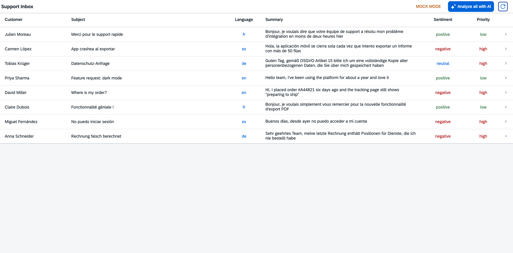

# Exercise 4 — Prompt API + JSON-schema output (AI-assistant track)

**Time:** 10 minutes. **Ends with:** Analyze produces valid `sentiment`, `category`,
`priority` chips on every ticket, constrained by a JSON Schema — no output parsing.

**Answer key:** [`docs/manual/06-prompt-structured.md`](../manual/06-prompt-structured.md)
shows both controller changes as diffs, each with the full file in a collapsed section.

## The prompt

```text
Chain ai.classify() into both analyze handlers. ai.ts is unchanged (classify() with
responseConstraint: CLASSIFICATION_SCHEMA is already there). Two files change:

1. List.controller.ts onAnalyzeAll: after the existing detect+summarize per row, add:
   - change the idempotency check from ?.summary to ?.priority (a row is "done" only after
     full classification);
   - compute bodyEn = (language==='en' || language==='und') ? body :
     await ai.translate(body, language, 'en').catch(() => body);
   - const cls = await ai.classify(bodyEn).catch(() => { console.warn(...); return null; });
   - if (cls) this._setResult(oAiModel, id, cls);
   Update the method doc comment to describe the 3-step pipeline.

2. Detail.controller.ts onAnalyze: after detect+summarize, add the same translate-then-
   classify chain and merge language + summary + ...(cls ?? {}) into ai>/results[id].

Do not change the views or formatters. Then run mcp__ui5__run_ui5_linter with fix:true.
```

## Concepts to confirm

- **Constrained decoding:** the schema is passed as `responseConstraint`; the decoder is
  masked at each token so only schema-valid JSON can be produced. It's not "the prompt asked
  for JSON". Ask the assistant to explain this if you want to check its understanding.
- **The schema is the contract:** `enum: ["low","medium","high"]` means the model literally
  cannot emit anything else.
- **English pivot for classification:** non-English tickets are translated to English before
  `classify()` so the classifier (English system prompt) performs consistently.
- **Idempotency moved to `?.priority`:** re-running Analyze finishes partially-done rows.

## Diff against the answer key

Compare both controllers against
[`docs/manual/06-prompt-structured.md`](../manual/06-prompt-structured.md). Catch:

- Idempotency check still on `?.summary` (should be `?.priority`)
- Missing `.catch(() => null)` around `classify` → a classify failure wipes the whole handler
- Classifying the original non-English body instead of `bodyEn`

## Verify

Click **Analyze all with AI**:

- [ ] Sentiment + Priority columns get colored chips
- [ ] Detail header shows Language, Sentiment, Category, Priority
- [ ] Spot-check (`?mock=1` is deterministic): Anna → negative/high; Priya → positive/low;
      Julien → positive/low

---

## What you should see



*(Screenshots captured in `?mock=1` mode.)*

---

Ready? → [Exercise 5: Writer API + graceful degradation](07-writer-fallback.md)
