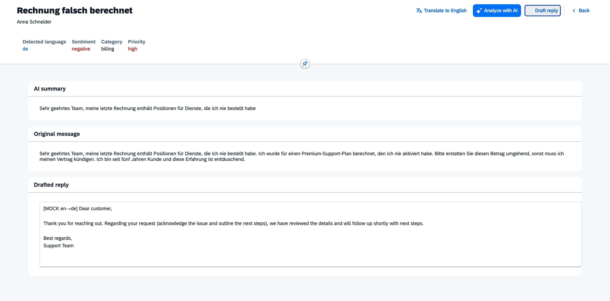

# Exercise 5 — Writer API + graceful degradation (AI-assistant track)

**Time:** 10 minutes. **Ends with:** the finished app — **Draft reply** produces a reply in
the customer's language, and first-run model downloads show a progress bar + stage label.

**Answer key:** [`docs/manual/07-writer-fallback.md`](../manual/07-writer-fallback.md) shows
all six changed files as diffs, each with the full file in a collapsed section.

## The prompt

```text
Final exercise: wire Draft reply and add download-progress UX. ai.ts is unchanged
(draftReply() with Writer→Prompt fallback is already there). Six files change:

1. Component.ts: add busyText:"" and progress:0 to the ai JSONModel.

2. i18n/i18n.properties: add ai.busy.detecting, ai.busy.summarizing, ai.busy.translating,
   ai.busy.classifying, ai.busy.drafting, and ai.busy.analyzing={0} / {1}.

3. List.view.xml: in headerContent add a Text (visible when ai>/busy) bound to ai>/busyText,
   and a ProgressIndicator visible when busy && progress>0 && progress<1 (remember XML
   escaping: &amp;&amp;, &gt;, &lt;), percentValue = ai>/progress * 100, displayValue
   i18n>ai.progress. Add busy="{ai>/busy}" busyIndicatorDelay="0" on the Table.

4. Detail.view.xml: same busyText Text + ProgressIndicator in the DynamicPageTitle actions,
   and busy="{ai>/busy}" busyIndicatorDelay="0" on the DynamicPage.

5. List.controller.ts onAnalyzeAll: build a `pending` list (rows missing ?.priority) for an
   n/total counter; a hooks object {onProgress: pct => set ai>/progress}; a setStage(key)
   that writes a localized label into ai>/busyText (analyzing uses [done+1, total]). Pass
   hooks to every ai.detectLanguage/summarize/translate/classify call; set stage labels
   between steps; increment done per ticket; clear busyText + progress in finally. Add
   imports for ResourceModel, ResourceBundle, and AiHooks.

6. Detail.controller.ts: add a private _aiUx() helper returning {model, bundle, hooks,
   setStage}; refactor onToggleTranslation and onAnalyze to use it (set progress 0 at start,
   clear busyText+progress in finally, call setStage before each AI op, pass hooks to every
   ai.* call). Implement onDraftReply: read language from ai>/results[id] (default 'en'),
   setStage('ai.busy.drafting'), ai.draftReply(body, "acknowledge the issue and outline the
   next steps", hooks); if language !== 'en' && !== 'und', setStage('ai.busy.translating')
   and ai.translate(draftEn, 'en', language, hooks).catch(()=>draftEn); store in
   detail>/draftedReply; toast "Reply drafted in {language}".

Then run mcp__ui5__run_ui5_linter with fix:true.
```

## Concepts to confirm

- **Graceful degradation:** `ai.draftReply()` tries Writer first, falls back to the Prompt
  API — the feature works with or without the Writer Origin Trial token.
- **Progress plumbing:** `ai.ts` fires `hooks.onProgress` from the `monitor.downloadprogress`
  event → controller sets `ai>/progress` → the view's `ProgressIndicator.percentValue` reacts.
- **English pivot in reverse:** the draft is generated in English, then translated
  `en → customer language`.
- **XML-escaped operators:** `&amp;&amp;`, `&gt;`, `&lt;` in the `visible` expressions.

## Diff against the answer key

Compare all six files against
[`docs/manual/07-writer-fallback.md`](../manual/07-writer-fallback.md). Catch:

- Un-escaped `&&` / `<` / `>` in XML → view fails to parse
- Forgetting to clear `busyText` + `progress` in `finally` → the label sticks after work ends
- `onDraftReply` translating when language is `und` → produces a bogus `[MOCK en→und]` draft

## The Writer Origin Trial token (optional)

Writer is OT in Chrome 148. Register a token at
[developer.chrome.com/origintrials](https://developer.chrome.com/origintrials) and paste it
into the commented `<meta http-equiv="origin-trial" ...>` line in `webapp/index.html`.
Without it, the Prompt-API fallback handles drafting.

## Verify

**Draft reply** (analyze a ticket first):

- [ ] Anna (DE) → reply in German (or `[MOCK en→de] …` on `?mock=1`)
- [ ] David (EN) → reply in English, no translate step
- [ ] Toast: "Reply drafted in de" / "en" / etc.

**Progress UX** (real Chrome, first run):

- [ ] Stage label appears during Analyze / Translate / Draft
- [ ] Progress bar visible while a model downloads
- [ ] Table + Detail show a busy overlay

On `?mock=1`: all features work; DevTools → Network shows **zero** outbound HTTP for AI.

---

## You're done 🎉

You drove an MCP-augmented assistant to build a UI5 app where four Chrome AI APIs
collaborate behind a single `ai.ts` seam, with `?mock=1` support and progress UX — all
on-device. Compare your journey against the [manual track](../manual/README.md): where did
the assistant save you time, and where did you have to correct it? That gap is the real
skill.

---

## What you should see



*(Screenshots captured in `?mock=1` mode.)*

