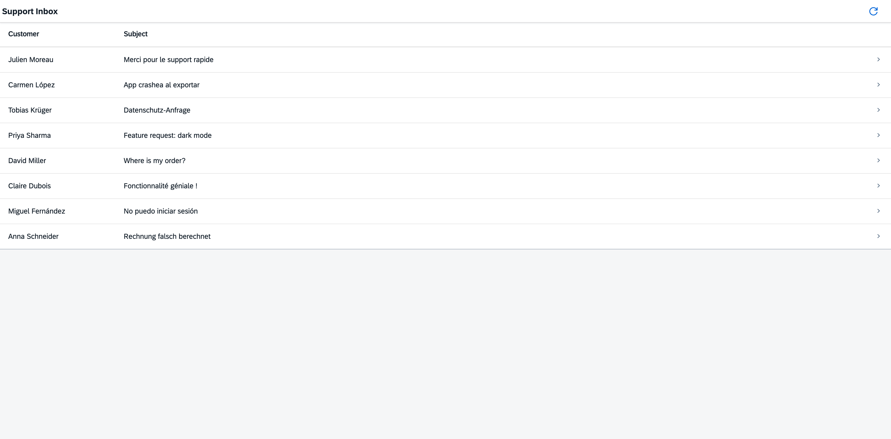

# Setup — Clone the starter + run the base app (manual track)

**Time:** 5 minutes. **Ends with:** the base UI5 list/detail app running against the
starter's data service. **No AI yet — and nothing to type.**

## Goal

Get the base app running and understand its shape, so Exercises 1–5 are pure **AI wiring**.

The starter already contains a complete, runnable UI5 app. You **clone it, install, and
run** — no boilerplate to paste. Then spend two minutes reading the files you'll extend.

## What the starter contains

Everything that isn't the point of this workshop is already there:

- A **base UI5 app** in `webapp/` — a list of 8 tickets and a detail page, in freestyle
  TypeScript, bound to the data service. This is what you'd otherwise spend 20 minutes
  scaffolding.
- A **shared `ai` JSONModel** already wired in `webapp/Component.ts` — the seam every later
  exercise writes to.
- An **OData V4 data service** (a small CAP app) serving the 8 tickets in four languages
  (DE, ES, FR, EN). A black box — you never touch it.
- All **tooling**: `package.json`, `tsconfig.json`, `babel.config.cjs`, `webapp/ui5.yaml`
  (data-service proxy pre-wired), `.mcp.json`.

From Exercise 1 on you edit files under `webapp/` (views, controllers, and a new
`webapp/model/` AI seam). You never edit the data service or the tooling.

---

## Step 1 — Clone and install

```bash
cd ~/dev                                  # or wherever you chose during setup
git clone https://github.com/SAP-samples/ui5con-2026-chrome-built-in-ai ui5con-2026-chrome-built-in-ai
cd ui5con-2026-chrome-built-in-ai
git checkout starter                      # the granted baseline: base app + data service + tooling
npm install
```

## Step 2 — Run it

```bash
npm start
```

Two servers start together:

- **Data service:** `http://localhost:4004/ticket/$metadata`
- **UI5 app:** `http://localhost:8080/index.html` (Chrome opens it automatically)

You should see the **Support Inbox** — 8 tickets, Customer + Subject columns. Click a row to
open its detail page with the message body.

> On a corporate-managed Chrome? Everything in this exercise works normally — the AI mocking
> (`?mock=1`) only matters from Exercise 1 on.

---

## Step 3 — Tour the files you'll extend

Spend two minutes reading these — Exercises 1–5 all build on them:

| File | What it is | You'll…|
|---|---|---|
| `webapp/Component.ts` | App bootstrap; creates the shared `ai` JSONModel | add fields to the `ai` model (Ch 4, 7) |
| `webapp/manifest.json` | App descriptor: data source, `ai` model, routes | (unchanged) |
| `webapp/view/List.view.xml` | The ticket table | add AI columns + an Analyze button (Ch 3) |
| `webapp/view/Detail.view.xml` | Single-ticket page | add action buttons + AI panels (Ch 3) |
| `webapp/controller/List.controller.ts` | List logic | wire Analyze-all (Ch 3, 4, 6, 7) |
| `webapp/controller/Detail.controller.ts` | Detail logic | wire Translate / Analyze / Draft (Ch 3–7) |
| `webapp/i18n/i18n.properties` | UI texts | add stage labels (Ch 7) |

The `ai` model in `Component.ts` starts minimal:

```typescript
const oAiModel = new JSONModel({
    summarizer: "unknown",
    translator: "unknown",
    languageDetector: "unknown",
    languageModel: "unknown",
    downloadPct: 0,
    busy: false,
    mock: new URLSearchParams(location.search).has("mock")
});
this.setModel(oAiModel, "ai");
```

Exercise 2 adds a `results` cache to it; Exercise 5 adds `busyText`/`progress`. Everything AI
flows through this model and the `webapp/model/ai.ts` seam you create in Exercise 1.

---

## Verify

- [ ] `http://localhost:8080` shows **Support Inbox** with **8 rows** — Anna, Miguel, Claire,
      David, Priya, Tobias, Carmen, Julien
- [ ] Columns: **Customer** and **Subject**
- [ ] Clicking a row opens a Detail page showing the message body
- [ ] The data service answers: `curl -s "http://localhost:4004/ticket/Tickets?\$top=1"` returns JSON

---

## Gotchas

- **Port 4004 or 8080 in use** → `lsof -ti:4004,8080 | xargs kill -9`, then `npm start`.
- **UI5 shows "OData model failed to load"** → the data service didn't start. Confirm
  `npm run start:cap` serves `http://localhost:4004/ticket/$metadata`. The proxy is
  pre-configured in the starter's `webapp/ui5.yaml` — you don't touch it.
- **`git checkout starter` says the branch doesn't exist** → `git fetch origin` first, or
  clone fresh; the starter is the workshop's baseline branch.

---

## What's next

Exercise 1 adds the AI UI scaffold (columns, buttons, status chips) and creates the `ai.ts`
seam that every Chrome AI call flows through.

## What you should see



*(Screenshots captured in `?mock=1` mode.)*

---

Ready? → [Exercise 1: UI scaffold + the `ai.ts` seam](03-ui-scaffold.md)
