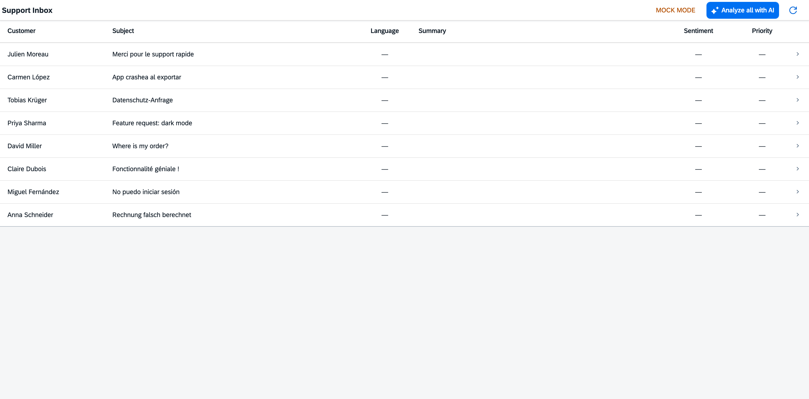

# Exercise 1 — UI scaffold + the `ai.ts` seam (manual track)

**Time:** 10 minutes. **Ends with:** the list shows four new AI columns (all `—`), the
detail page has three action buttons that toast "not wired yet", and the **complete
`ai.ts` shim** is in place with a mock behind `?mock=1`.

## Goal

Get all the UI plumbing and the AI seam done in one shot, so Exercises 2–5 are pure
**controller wiring** — not Chrome API archaeology.

You will:

- **Add** `webapp/model/ai.ts` — the seam. Every Chrome API method is implemented here.
- **Add** `webapp/model/ai.mock.ts` — deterministic fake behind `?mock=1`.
- **Replace** both views to add AI columns / action buttons / status chips.
- **Replace** both controllers with stub handlers that toast "not wired yet" and a status probe.

`Component.ts` does **not** change in this exercise.

## Why the seam matters

**Controllers never touch `Summarizer` / `Translator` / `LanguageDetector` /
`LanguageModel` / `Writer` directly.** They call `ai.summarize(...)`, `ai.translate(...)`,
`ai.classify(...)`, `ai.draftReply(...)`. One file knows about the Chrome globals; the
rest of the app doesn't care. That single seam is also where `?mock=1` swaps the whole
implementation:

```typescript
const useMock = new URLSearchParams(location.search).has("mock");
export const ai = useMock ? mockAI : new RealAI();
```

The shim ships **complete** now so you can read every Chrome API pattern in one file, then
spend Exercises 2–5 learning how controllers call into it.

---

## Step 1 — Add the AI shim

> **File:** `webapp/model/ai.ts` — _new file, shown in full_

```typescript
// Chrome Built-in AI shim.
//
// Every controller talks to this module — never to `LanguageModel`, `Summarizer`,
// `Translator`, or `LanguageDetector` directly. That gives us a single seam where
// we can:
//   - swap in the mock implementation via `?mock=1` for offline demos
//   - wire download-progress into the shared `ai` JSONModel
//   - fall back gracefully when a specific API isn't available
//
// The Chrome API globals (`LanguageModel`, `Summarizer`, `Translator`,
// `LanguageDetector`, `Writer`, `Rewriter`) are typed by @types/dom-chromium-ai.

import { mockAI } from "./ai.mock";

export type Availability = "unavailable" | "downloadable" | "downloading" | "available";

export interface LanguageDetection {
    detectedLanguage: string;
    confidence: number;
}

export interface TicketClassification {
    sentiment: "positive" | "neutral" | "negative";
    category: "billing" | "technical" | "account" | "shipping" | "other";
    priority: "low" | "medium" | "high";
}

const CLASSIFICATION_SCHEMA = {
    type: "object",
    required: ["sentiment", "category", "priority"],
    additionalProperties: false,
    properties: {
        sentiment: { enum: ["positive", "neutral", "negative"] },
        category:  { enum: ["billing", "technical", "account", "shipping", "other"] },
        priority:  { enum: ["low", "medium", "high"] }
    }
};

const CLASSIFIER_SYSTEM = `You are a support-ticket triage classifier. \
Read the ticket body and reply with a JSON object matching the schema. \
Rules:
- "priority": "high" for outages, security, regulatory (GDPR), billing disputes, or churn threats.
- "priority": "low" for compliments, feature requests, and thank-you notes.
- "sentiment" reflects the customer's emotional tone.
- "category" picks the closest bucket.`;

export interface AiHooks {
    onProgress?: (pct: number) => void;
    onStatus?: (api: string, s: Availability) => void;
}

class RealAI {
    private _summarizer: any = null;
    private _languageDetector: any = null;
    private _translators: Map<string, any> = new Map();
    private _languageModel: any = null;

    async status(): Promise<Record<string, Availability>> {
        const has = (name: string) => name in self;
        const call = async (name: string, fn: () => Promise<Availability>): Promise<Availability> =>
            has(name) ? (await fn().catch(() => "unavailable")) : "unavailable";

        return {
            summarizer:       await call("Summarizer",       () => (self as any).Summarizer.availability()),
            languageDetector: await call("LanguageDetector", () => (self as any).LanguageDetector.availability()),
            languageModel:    await call("LanguageModel",    () => (self as any).LanguageModel.availability()),
            translator:       await call("Translator",       () => (self as any).Translator.availability({
                sourceLanguage: "de",
                targetLanguage: "en"
            }))
        };
    }

    async summarize(text: string, hooks?: AiHooks): Promise<string> {
        if (!("Summarizer" in self)) throw new Error("Summarizer API not available");
        if (!this._summarizer) {
            this._summarizer = await (self as any).Summarizer.create({
                type: "tldr",
                length: "short",
                format: "plain-text",
                monitor: (m: any) => m.addEventListener("downloadprogress", (e: any) => hooks?.onProgress?.(e.loaded))
            });
        }
        return this._summarizer.summarize(text);
    }

    async detectLanguage(text: string, hooks?: AiHooks): Promise<LanguageDetection[]> {
        if (!("LanguageDetector" in self)) throw new Error("LanguageDetector API not available");
        if (!this._languageDetector) {
            this._languageDetector = await (self as any).LanguageDetector.create({
                monitor: (m: any) => m.addEventListener("downloadprogress", (e: any) => hooks?.onProgress?.(e.loaded))
            });
        }
        const results = await this._languageDetector.detect(text);
        return results.filter((r: any) => r.detectedLanguage !== "und" && r.confidence > 0.4);
    }

    async translate(text: string, sourceLanguage: string, targetLanguage: string, hooks?: AiHooks): Promise<string> {
        if (!("Translator" in self)) throw new Error("Translator API not available");
        if (sourceLanguage === targetLanguage) return text;
        const key = `${sourceLanguage}:${targetLanguage}`;
        let translator = this._translators.get(key);
        if (!translator) {
            translator = await (self as any).Translator.create({
                sourceLanguage,
                targetLanguage,
                monitor: (m: any) => m.addEventListener("downloadprogress", (e: any) => hooks?.onProgress?.(e.loaded))
            });
            this._translators.set(key, translator);
        }
        return translator.translate(text);
    }

    async classify(ticketBody: string, hooks?: AiHooks): Promise<TicketClassification> {
        if (!("LanguageModel" in self)) throw new Error("LanguageModel API not available");
        if (!this._languageModel) {
            this._languageModel = await (self as any).LanguageModel.create({
                initialPrompts: [{ role: "system", content: CLASSIFIER_SYSTEM }],
                expectedInputs: [{ type: "text", languages: ["en"] }],
                monitor: (m: any) => m.addEventListener("downloadprogress", (e: any) => hooks?.onProgress?.(e.loaded))
            });
        }
        const raw: string = await this._languageModel.prompt(ticketBody, {
            responseConstraint: CLASSIFICATION_SCHEMA
        });
        return JSON.parse(raw);
    }

    async draftReply(ticketBody: string, agentIntent: string, hooks?: AiHooks): Promise<string> {
        if ("Writer" in self) {
            const writer = await (self as any).Writer.create({
                tone: "formal",
                length: "medium",
                format: "plain-text",
                sharedContext: `Customer support reply. Original ticket: "${ticketBody}"`,
                monitor: (m: any) => m.addEventListener("downloadprogress", (e: any) => hooks?.onProgress?.(e.loaded))
            });
            return writer.write(agentIntent);
        }
        // Fallback: use the Prompt API when Writer isn't in this Chrome build (still OT as of July 2026)
        if ("LanguageModel" in self) {
            const session = await (self as any).LanguageModel.create({
                initialPrompts: [{
                    role: "system",
                    content: "You draft polite, professional customer-support replies. Reply text only, no preamble."
                }]
            });
            return session.prompt(`Ticket:\n${ticketBody}\n\nDraft a reply. Agent intent: ${agentIntent}`);
        }
        throw new Error("Neither Writer nor LanguageModel is available");
    }
}

const useMock = new URLSearchParams(location.search).has("mock");

export const ai = useMock ? mockAI : new RealAI();
```

## Step 2 — Add the mock

> **File:** `webapp/model/ai.mock.ts` — _new file, shown in full_
>
> Deterministic fake that regex-matches the ticket body. Same interface as `RealAI`.

```typescript
// Deterministic mock AI for `?mock=1` mode. Same interface as ai.ts's RealAI,
// canned to make the demo work when Chrome AI APIs aren't installed.

import type { Availability, LanguageDetection, TicketClassification, AiHooks } from "./ai";

function guessLang(text: string): string {
    const lc = text.toLowerCase();
    if (/[äöüß]|(bitte|guten|sehr|nicht|meine|ich)/.test(lc)) return "de";
    if (/[ñ¿¡]|(gracias|hola|buenos|no puedo|necesito)/.test(lc)) return "es";
    if (/(bonjour|merci|voulais|s'il|très|vous)/.test(lc)) return "fr";
    return "en";
}

function guessSentiment(text: string): TicketClassification["sentiment"] {
    const lc = text.toLowerCase();
    if (/(unacceptable|refund|angry|kündigen|enttäuschend|urgent|crash|bloqueando|inaccept)/.test(lc)) return "negative";
    if (/(thank|thanks|merci|gracias|love|impressive|great|geniale|bravo)/.test(lc)) return "positive";
    return "neutral";
}

function guessCategory(text: string): TicketClassification["category"] {
    const lc = text.toLowerCase();
    if (/(bill|invoice|rechnung|refund|charge)/.test(lc)) return "billing";
    if (/(login|password|contraseña|account|access|gdpr|dsgvo|datenschutz)/.test(lc)) return "account";
    if (/(order|ship|tracking|paquet)/.test(lc)) return "shipping";
    if (/(crash|bug|error|feature|dark mode|export)/.test(lc)) return "technical";
    return "other";
}

function guessPriority(text: string): TicketClassification["priority"] {
    const s = guessSentiment(text);
    const lc = text.toLowerCase();
    if (s === "positive") return "low";
    if (/(gdpr|dsgvo|refund|kündigen|urgent|crash|bloqueando|inaccept)/.test(lc)) return "high";
    if (s === "negative") return "medium";
    return "low";
}

async function fakeDelay<T>(v: T, ms = 400): Promise<T> {
    await new Promise((r) => setTimeout(r, ms));
    return v;
}

export const mockAI = {
    async status(): Promise<Record<string, Availability>> {
        return {
            summarizer: "available",
            languageDetector: "available",
            languageModel: "available",
            translator: "available"
        };
    },

    async summarize(text: string, _hooks?: AiHooks): Promise<string> {
        // First sentence, trimmed to ~140 chars — good enough for a mock
        const first = text.split(/[.!?]\s/)[0] || text;
        return fakeDelay(first.length > 140 ? first.slice(0, 137) + "…" : first);
    },

    async detectLanguage(text: string, _hooks?: AiHooks): Promise<LanguageDetection[]> {
        return fakeDelay([{ detectedLanguage: guessLang(text), confidence: 0.95 }]);
    },

    async translate(text: string, sourceLanguage: string, targetLanguage: string, _hooks?: AiHooks): Promise<string> {
        if (sourceLanguage === targetLanguage) return text;
        return fakeDelay(`[MOCK ${sourceLanguage}→${targetLanguage}] ${text}`);
    },

    async classify(text: string, _hooks?: AiHooks): Promise<TicketClassification> {
        return fakeDelay({
            sentiment: guessSentiment(text),
            category: guessCategory(text),
            priority: guessPriority(text)
        });
    },

    async draftReply(_ticketBody: string, agentIntent: string, _hooks?: AiHooks): Promise<string> {
        return fakeDelay(
            `Dear customer,\n\nThank you for reaching out. Regarding your request (${agentIntent}), ` +
            `we have reviewed the details and will follow up shortly with next steps.\n\nBest regards,\nSupport Team`,
            600
        );
    }
};
```

> **Why the ordering matters:** `ai.ts` imports `mockAI` from `ai.mock.ts`, and
> `ai.mock.ts` imports *types only* from `ai.ts`. Type-only imports are erased at compile
> time, so there's no runtime cycle. Create both files before you reload.

## Step 3 — Update the List view (add 4 AI columns + header)

The table gains four AI columns and the header gains a status chip and an **Analyze all**
button. The AI cells bind to the **OData fields** for now (`{detectedLanguage}` etc.),
which are empty in the seed data — so every AI cell shows `—`. Exercise 2 rebinds them to
`ai>/results`.

> **File:** `webapp/view/List.view.xml` — _apply this change_

```diff
diff --git a/webapp/view/List.view.xml b/webapp/view/List.view.xml
index 33cfaae..5e6af1c 100644
--- a/webapp/view/List.view.xml
+++ b/webapp/view/List.view.xml
@@ -1,6 +1,8 @@
 <mvc:View
     controllerName="workshop.ticket.controller.List"
     xmlns:mvc="sap.ui.core.mvc"
+    xmlns:core="sap.ui.core"
+    xmlns:f="sap.f"
     xmlns="sap.m">
 
     <Page
@@ -9,6 +11,17 @@
         showNavButton="false">
 
         <headerContent>
+            <ObjectStatus
+                text="{= ${ai>/mock} ? 'MOCK MODE' : ${ai>/summarizer} }"
+                state="{= ${ai>/mock} ? 'Warning' : (${ai>/summarizer} === 'available' ? 'Success' : 'Error') }"
+                class="sapUiSmallMarginEnd"/>
+            <Button
+                id="btnAnalyzeAll"
+                text="{i18n>button.analyzeAll}"
+                type="Emphasized"
+                icon="sap-icon://ai"
+                press=".onAnalyzeAll"
+                enabled="{= !${ai>/busy} }"/>
             <Button
                 icon="sap-icon://refresh"
                 tooltip="{i18n>button.refresh}"
@@ -21,7 +34,7 @@
                 items="{
                     path: '/Tickets',
                     parameters: {
-                        $select: 'ID,subject,customer,body,submitted',
+                        $select: 'ID,subject,customer,body,submitted,detectedLanguage,summary,sentiment,category,priority',
                         $orderby: 'submitted desc'
                     }
                 }"
@@ -32,6 +45,10 @@
                 <columns>
                     <Column width="14rem"><Text text="{i18n>column.customer}"/></Column>
                     <Column><Text text="{i18n>column.subject}"/></Column>
+                    <Column width="8rem" hAlign="Center"><Text text="{i18n>column.language}"/></Column>
+                    <Column><Text text="{i18n>column.summary}"/></Column>
+                    <Column width="10rem" hAlign="Center"><Text text="{i18n>column.sentiment}"/></Column>
+                    <Column width="7rem" hAlign="Center"><Text text="{i18n>column.priority}"/></Column>
                 </columns>
 
                 <items>
@@ -39,6 +56,16 @@
                         <cells>
                             <Text text="{customer}"/>
                             <Text text="{subject}"/>
+                            <ObjectStatus
+                                text="{= ${detectedLanguage} || '—' }"
+                                state="{= ${detectedLanguage} ? 'Information' : 'None' }"/>
+                            <Text text="{= ${summary} || '' }" maxLines="2"/>
+                            <ObjectStatus
+                                text="{= ${sentiment} || '—' }"
+                                state="{= ${sentiment} === 'positive' ? 'Success' : (${sentiment} === 'negative' ? 'Error' : (${sentiment} === 'neutral' ? 'Information' : 'None')) }"/>
+                            <ObjectStatus
+                                text="{= ${priority} || '—' }"
+                                state="{= ${priority} === 'high' ? 'Error' : (${priority} === 'medium' ? 'Warning' : (${priority} === 'low' ? 'Success' : 'None')) }"/>
                         </cells>
                     </ColumnListItem>
                 </items>
```

<details>
<summary>Full <code>webapp/view/List.view.xml</code> after this change — copy this if you get lost</summary>

```xml
<mvc:View
    controllerName="workshop.ticket.controller.List"
    xmlns:mvc="sap.ui.core.mvc"
    xmlns:core="sap.ui.core"
    xmlns:f="sap.f"
    xmlns="sap.m">

    <Page
        id="listPage"
        title="{i18n>listTitle}"
        showNavButton="false">

        <headerContent>
            <ObjectStatus
                text="{= ${ai>/mock} ? 'MOCK MODE' : ${ai>/summarizer} }"
                state="{= ${ai>/mock} ? 'Warning' : (${ai>/summarizer} === 'available' ? 'Success' : 'Error') }"
                class="sapUiSmallMarginEnd"/>
            <Button
                id="btnAnalyzeAll"
                text="{i18n>button.analyzeAll}"
                type="Emphasized"
                icon="sap-icon://ai"
                press=".onAnalyzeAll"
                enabled="{= !${ai>/busy} }"/>
            <Button
                icon="sap-icon://refresh"
                tooltip="{i18n>button.refresh}"
                press=".onRefresh"/>
        </headerContent>

        <content>
            <Table
                id="ticketTable"
                items="{
                    path: '/Tickets',
                    parameters: {
                        $select: 'ID,subject,customer,body,submitted,detectedLanguage,summary,sentiment,category,priority',
                        $orderby: 'submitted desc'
                    }
                }"
                growing="true"
                growingThreshold="20"
                mode="None">

                <columns>
                    <Column width="14rem"><Text text="{i18n>column.customer}"/></Column>
                    <Column><Text text="{i18n>column.subject}"/></Column>
                    <Column width="8rem" hAlign="Center"><Text text="{i18n>column.language}"/></Column>
                    <Column><Text text="{i18n>column.summary}"/></Column>
                    <Column width="10rem" hAlign="Center"><Text text="{i18n>column.sentiment}"/></Column>
                    <Column width="7rem" hAlign="Center"><Text text="{i18n>column.priority}"/></Column>
                </columns>

                <items>
                    <ColumnListItem type="Navigation" press=".onOpenDetail">
                        <cells>
                            <Text text="{customer}"/>
                            <Text text="{subject}"/>
                            <ObjectStatus
                                text="{= ${detectedLanguage} || '—' }"
                                state="{= ${detectedLanguage} ? 'Information' : 'None' }"/>
                            <Text text="{= ${summary} || '' }" maxLines="2"/>
                            <ObjectStatus
                                text="{= ${sentiment} || '—' }"
                                state="{= ${sentiment} === 'positive' ? 'Success' : (${sentiment} === 'negative' ? 'Error' : (${sentiment} === 'neutral' ? 'Information' : 'None')) }"/>
                            <ObjectStatus
                                text="{= ${priority} || '—' }"
                                state="{= ${priority} === 'high' ? 'Error' : (${priority} === 'medium' ? 'Warning' : (${priority} === 'low' ? 'Success' : 'None')) }"/>
                        </cells>
                    </ColumnListItem>
                </items>
            </Table>
        </content>
    </Page>
</mvc:View>
```

</details>

## Step 4 — Update the Detail view (actions + status chips + panels)

Three actions in the title bar (Translate / Analyze / Draft reply), a header with four
status chips (bound to OData fields for now), and three content panels: AI summary,
Original message (toggles to translation), and Drafted reply (hidden until populated).

> **File:** `webapp/view/Detail.view.xml` — _apply this change_

```diff
diff --git a/webapp/view/Detail.view.xml b/webapp/view/Detail.view.xml
index 6f23e68..9e63e97 100644
--- a/webapp/view/Detail.view.xml
+++ b/webapp/view/Detail.view.xml
@@ -17,6 +17,24 @@
                 <f:expandedContent>
                     <Text text="{customer}"/>
                 </f:expandedContent>
+                <f:actions>
+                    <Button
+                        text="{= ${detail>/showingTranslation} ? ${i18n>button.showOriginal} : ${i18n>button.translate} }"
+                        icon="sap-icon://translate"
+                        press=".onToggleTranslation"
+                        enabled="{= !${ai>/busy} }"/>
+                    <Button
+                        text="{i18n>button.analyze}"
+                        icon="sap-icon://ai"
+                        type="Emphasized"
+                        press=".onAnalyze"
+                        enabled="{= !${ai>/busy} }"/>
+                    <Button
+                        text="{i18n>button.draftReply}"
+                        icon="sap-icon://compose"
+                        press=".onDraftReply"
+                        enabled="{= !${ai>/busy} }"/>
+                </f:actions>
                 <f:navigationActions>
                     <Button
                         icon="sap-icon://nav-back"
@@ -26,10 +44,58 @@
             </f:DynamicPageTitle>
         </f:title>
 
+        <f:header>
+            <f:DynamicPageHeader pinnable="true">
+                <HBox wrap="Wrap" alignItems="Center" class="sapUiSmallMargin">
+                    <VBox class="sapUiSmallMarginEnd">
+                        <Label text="{i18n>detail.language}" design="Bold"/>
+                        <ObjectStatus text="{= ${detectedLanguage} || '—' }" state="Information"/>
+                    </VBox>
+                    <VBox class="sapUiSmallMarginEnd">
+                        <Label text="{i18n>detail.sentiment}" design="Bold"/>
+                        <ObjectStatus
+                            text="{= ${sentiment} || '—' }"
+                            state="{= ${sentiment} === 'positive' ? 'Success' : (${sentiment} === 'negative' ? 'Error' : (${sentiment} === 'neutral' ? 'Information' : 'None')) }"/>
+                    </VBox>
+                    <VBox class="sapUiSmallMarginEnd">
+                        <Label text="{i18n>detail.category}" design="Bold"/>
+                        <ObjectStatus text="{= ${category} || '—' }"/>
+                    </VBox>
+                    <VBox class="sapUiSmallMarginEnd">
+                        <Label text="{i18n>detail.priority}" design="Bold"/>
+                        <ObjectStatus
+                            text="{= ${priority} || '—' }"
+                            state="{= ${priority} === 'high' ? 'Error' : (${priority} === 'medium' ? 'Warning' : (${priority} === 'low' ? 'Success' : 'None')) }"/>
+                    </VBox>
+                </HBox>
+            </f:DynamicPageHeader>
+        </f:header>
+
         <f:content>
             <VBox class="sapUiMediumMargin">
-                <Panel headerText="{i18n>detail.body}" expandable="false" backgroundDesign="Solid">
-                    <Text text="{body}" class="sapUiSmallMargin"/>
+                <Panel headerText="{i18n>detail.summary}" expandable="false" backgroundDesign="Solid">
+                    <Text text="{= ${summary} || 'Click Analyze to generate a summary.' }" class="sapUiSmallMargin"/>
+                </Panel>
+
+                <Panel
+                    headerText="{= ${detail>/showingTranslation} ? ${i18n>detail.translated} : ${i18n>detail.body} }"
+                    expandable="false"
+                    class="sapUiSmallMarginTop"
+                    backgroundDesign="Solid">
+                    <Text text="{= ${detail>/showingTranslation} ? ${detail>/translatedBody} : ${body} }" class="sapUiSmallMargin"/>
+                </Panel>
+
+                <Panel
+                    visible="{= !!${detail>/draftedReply} }"
+                    headerText="{i18n>detail.reply}"
+                    expandable="false"
+                    class="sapUiSmallMarginTop"
+                    backgroundDesign="Solid">
+                    <TextArea
+                        value="{detail>/draftedReply}"
+                        rows="8"
+                        width="100%"
+                        class="sapUiSmallMargin"/>
                 </Panel>
             </VBox>
         </f:content>
```

<details>
<summary>Full <code>webapp/view/Detail.view.xml</code> after this change — copy this if you get lost</summary>

```xml
<mvc:View
    controllerName="workshop.ticket.controller.Detail"
    xmlns:mvc="sap.ui.core.mvc"
    xmlns:f="sap.f"
    xmlns="sap.m">

    <f:DynamicPage id="detailPage" toggleHeaderOnTitleClick="false">

        <f:title>
            <f:DynamicPageTitle>
                <f:heading>
                    <Title text="{subject}"/>
                </f:heading>
                <f:snappedContent>
                    <Text text="{customer}"/>
                </f:snappedContent>
                <f:expandedContent>
                    <Text text="{customer}"/>
                </f:expandedContent>
                <f:actions>
                    <Button
                        text="{= ${detail>/showingTranslation} ? ${i18n>button.showOriginal} : ${i18n>button.translate} }"
                        icon="sap-icon://translate"
                        press=".onToggleTranslation"
                        enabled="{= !${ai>/busy} }"/>
                    <Button
                        text="{i18n>button.analyze}"
                        icon="sap-icon://ai"
                        type="Emphasized"
                        press=".onAnalyze"
                        enabled="{= !${ai>/busy} }"/>
                    <Button
                        text="{i18n>button.draftReply}"
                        icon="sap-icon://compose"
                        press=".onDraftReply"
                        enabled="{= !${ai>/busy} }"/>
                </f:actions>
                <f:navigationActions>
                    <Button
                        icon="sap-icon://nav-back"
                        text="{i18n>button.back}"
                        press=".onBack"/>
                </f:navigationActions>
            </f:DynamicPageTitle>
        </f:title>

        <f:header>
            <f:DynamicPageHeader pinnable="true">
                <HBox wrap="Wrap" alignItems="Center" class="sapUiSmallMargin">
                    <VBox class="sapUiSmallMarginEnd">
                        <Label text="{i18n>detail.language}" design="Bold"/>
                        <ObjectStatus text="{= ${detectedLanguage} || '—' }" state="Information"/>
                    </VBox>
                    <VBox class="sapUiSmallMarginEnd">
                        <Label text="{i18n>detail.sentiment}" design="Bold"/>
                        <ObjectStatus
                            text="{= ${sentiment} || '—' }"
                            state="{= ${sentiment} === 'positive' ? 'Success' : (${sentiment} === 'negative' ? 'Error' : (${sentiment} === 'neutral' ? 'Information' : 'None')) }"/>
                    </VBox>
                    <VBox class="sapUiSmallMarginEnd">
                        <Label text="{i18n>detail.category}" design="Bold"/>
                        <ObjectStatus text="{= ${category} || '—' }"/>
                    </VBox>
                    <VBox class="sapUiSmallMarginEnd">
                        <Label text="{i18n>detail.priority}" design="Bold"/>
                        <ObjectStatus
                            text="{= ${priority} || '—' }"
                            state="{= ${priority} === 'high' ? 'Error' : (${priority} === 'medium' ? 'Warning' : (${priority} === 'low' ? 'Success' : 'None')) }"/>
                    </VBox>
                </HBox>
            </f:DynamicPageHeader>
        </f:header>

        <f:content>
            <VBox class="sapUiMediumMargin">
                <Panel headerText="{i18n>detail.summary}" expandable="false" backgroundDesign="Solid">
                    <Text text="{= ${summary} || 'Click Analyze to generate a summary.' }" class="sapUiSmallMargin"/>
                </Panel>

                <Panel
                    headerText="{= ${detail>/showingTranslation} ? ${i18n>detail.translated} : ${i18n>detail.body} }"
                    expandable="false"
                    class="sapUiSmallMarginTop"
                    backgroundDesign="Solid">
                    <Text text="{= ${detail>/showingTranslation} ? ${detail>/translatedBody} : ${body} }" class="sapUiSmallMargin"/>
                </Panel>

                <Panel
                    visible="{= !!${detail>/draftedReply} }"
                    headerText="{i18n>detail.reply}"
                    expandable="false"
                    class="sapUiSmallMarginTop"
                    backgroundDesign="Solid">
                    <TextArea
                        value="{detail>/draftedReply}"
                        rows="8"
                        width="100%"
                        class="sapUiSmallMargin"/>
                </Panel>
            </VBox>
        </f:content>
    </f:DynamicPage>
</mvc:View>
```

</details>

## Step 5 — Update the List controller (status probe + stub)

`onInit` probes Chrome AI availability into the shared `ai` model (so the header chip is
accurate), and `onAnalyzeAll` toasts "not wired yet".

> **File:** `webapp/controller/List.controller.ts` — _apply this change_

```diff
diff --git a/webapp/controller/List.controller.ts b/webapp/controller/List.controller.ts
index c140470..9aee216 100644
--- a/webapp/controller/List.controller.ts
+++ b/webapp/controller/List.controller.ts
@@ -1,19 +1,32 @@
 import Controller from "sap/ui/core/mvc/Controller";
 import UIComponent from "sap/ui/core/UIComponent";
 import Event from "sap/ui/base/Event";
+import MessageToast from "sap/m/MessageToast";
+import { ai } from "../model/ai";
 
 /**
  * List Report — the support inbox.
  *
- * starter: bare bones. Customer + Subject columns from CAP.
- * Coming next: AI columns, analyze-all button, etc.
+ * exercise-1: table has AI columns wired to the data model but not
+ * populated yet. Buttons trigger a "not wired yet" toast. onInit probes
+ * the Chrome AI status and stores it in the shared `ai` JSONModel so the
+ * header chip stays accurate.
  *
  * @namespace workshop.ticket.controller
  */
 export default class List extends Controller {
 
     public onInit(): void {
-        // no-op
+        void this._probeAiStatus();
+    }
+
+    private async _probeAiStatus(): Promise<void> {
+        const oAiModel = (this.getOwnerComponent() as UIComponent).getModel("ai") as any;
+        const status = await ai.status();
+        oAiModel.setProperty("/summarizer", status.summarizer);
+        oAiModel.setProperty("/translator", status.translator);
+        oAiModel.setProperty("/languageDetector", status.languageDetector);
+        oAiModel.setProperty("/languageModel", status.languageModel);
     }
 
     public onOpenDetail(oEvent: Event): void {
@@ -28,4 +41,12 @@ export default class List extends Controller {
         const oBinding = (this.byId("ticketTable") as any).getBinding("items");
         oBinding?.refresh();
     }
+
+    /**
+     * exercise-2 fills in Summarizer + LanguageDetector.
+     * exercise-4 adds Prompt-API classification.
+     */
+    public async onAnalyzeAll(): Promise<void> {
+        MessageToast.show("Analyze not wired yet — see exercise-2 / exercise-4");
+    }
 }
```

<details>
<summary>Full <code>webapp/controller/List.controller.ts</code> after this change — copy this if you get lost</summary>

```typescript
import Controller from "sap/ui/core/mvc/Controller";
import UIComponent from "sap/ui/core/UIComponent";
import Event from "sap/ui/base/Event";
import MessageToast from "sap/m/MessageToast";
import { ai } from "../model/ai";

/**
 * List Report — the support inbox.
 *
 * exercise-1: table has AI columns wired to the data model but not
 * populated yet. Buttons trigger a "not wired yet" toast. onInit probes
 * the Chrome AI status and stores it in the shared `ai` JSONModel so the
 * header chip stays accurate.
 *
 * @namespace workshop.ticket.controller
 */
export default class List extends Controller {

    public onInit(): void {
        void this._probeAiStatus();
    }

    private async _probeAiStatus(): Promise<void> {
        const oAiModel = (this.getOwnerComponent() as UIComponent).getModel("ai") as any;
        const status = await ai.status();
        oAiModel.setProperty("/summarizer", status.summarizer);
        oAiModel.setProperty("/translator", status.translator);
        oAiModel.setProperty("/languageDetector", status.languageDetector);
        oAiModel.setProperty("/languageModel", status.languageModel);
    }

    public onOpenDetail(oEvent: Event): void {
        const oItem = oEvent.getSource() as any;
        const oContext = oItem.getBindingContext();
        if (!oContext) return;
        const sKey = encodeURIComponent(oContext.getProperty("ID"));
        (this.getOwnerComponent() as UIComponent).getRouter().navTo("detail", { key: sKey });
    }

    public onRefresh(): void {
        const oBinding = (this.byId("ticketTable") as any).getBinding("items");
        oBinding?.refresh();
    }

    /**
     * exercise-2 fills in Summarizer + LanguageDetector.
     * exercise-4 adds Prompt-API classification.
     */
    public async onAnalyzeAll(): Promise<void> {
        MessageToast.show("Analyze not wired yet — see exercise-2 / exercise-4");
    }
}
```

</details>

## Step 6 — Update the Detail controller (local model + stubs)

Adds a view-local `detail` JSONModel for per-view state, resets it on route match, and
stubs the three AI handlers.

> **File:** `webapp/controller/Detail.controller.ts` — _apply this change_

```diff
diff --git a/webapp/controller/Detail.controller.ts b/webapp/controller/Detail.controller.ts
index ee406ca..d4b0d1f 100644
--- a/webapp/controller/Detail.controller.ts
+++ b/webapp/controller/Detail.controller.ts
@@ -1,17 +1,28 @@
 import Controller from "sap/ui/core/mvc/Controller";
 import UIComponent from "sap/ui/core/UIComponent";
+import JSONModel from "sap/ui/model/json/JSONModel";
+import MessageToast from "sap/m/MessageToast";
 import type Route from "sap/ui/core/routing/Route";
 
 /**
  * Object Page — a single ticket.
  *
- * starter: shows the raw message body. AI actions come next.
+ * exercise-1: header + panels are wired to the data model, action
+ * buttons exist but their handlers just toast "not wired yet". A local
+ * `detail` JSONModel holds view-only state (showing translation, drafted reply).
  *
  * @namespace workshop.ticket.controller
  */
 export default class Detail extends Controller {
 
+    private _detailModel = new JSONModel({
+        showingTranslation: false,
+        translatedBody: "",
+        draftedReply: ""
+    });
+
     public onInit(): void {
+        this.getView()?.setModel(this._detailModel, "detail");
         const oRouter = (this.getOwnerComponent() as UIComponent).getRouter();
         (oRouter.getRoute("detail") as Route).attachPatternMatched(this._onRouteMatched, this);
     }
@@ -20,8 +31,11 @@ export default class Detail extends Controller {
         const key = decodeURIComponent(oEvent.getParameter("arguments").key);
         this.getView()?.bindElement({
             path: `/Tickets(ID=${key},IsActiveEntity=true)`,
-            parameters: { $select: "ID,subject,body,customer,submitted" }
+            parameters: {
+                $select: "ID,subject,body,customer,submitted,detectedLanguage,summary,sentiment,category,priority"
+            }
         });
+        this._detailModel.setData({ showingTranslation: false, translatedBody: "", draftedReply: "" });
     }
 
     public onBack(): void {
@@ -29,4 +43,19 @@ export default class Detail extends Controller {
             ? window.history.back()
             : (this.getOwnerComponent() as UIComponent).getRouter().navTo("list", {}, true);
     }
+
+    /** exercise-3 wires this to the Translator API */
+    public async onToggleTranslation(): Promise<void> {
+        MessageToast.show("Translation not wired yet — see exercise-3");
+    }
+
+    /** exercise-2 wires Summarizer + LanguageDetector; exercise-4 adds Prompt classify */
+    public async onAnalyze(): Promise<void> {
+        MessageToast.show("Analyze not wired yet — see exercises 2 & 4");
+    }
+
+    /** exercise-5 wires this to the Writer API (OT-gated) with Prompt fallback */
+    public async onDraftReply(): Promise<void> {
+        MessageToast.show("Reply drafting not wired yet — see exercise-5");
+    }
 }
```

<details>
<summary>Full <code>webapp/controller/Detail.controller.ts</code> after this change — copy this if you get lost</summary>

```typescript
import Controller from "sap/ui/core/mvc/Controller";
import UIComponent from "sap/ui/core/UIComponent";
import JSONModel from "sap/ui/model/json/JSONModel";
import MessageToast from "sap/m/MessageToast";
import type Route from "sap/ui/core/routing/Route";

/**
 * Object Page — a single ticket.
 *
 * exercise-1: header + panels are wired to the data model, action
 * buttons exist but their handlers just toast "not wired yet". A local
 * `detail` JSONModel holds view-only state (showing translation, drafted reply).
 *
 * @namespace workshop.ticket.controller
 */
export default class Detail extends Controller {

    private _detailModel = new JSONModel({
        showingTranslation: false,
        translatedBody: "",
        draftedReply: ""
    });

    public onInit(): void {
        this.getView()?.setModel(this._detailModel, "detail");
        const oRouter = (this.getOwnerComponent() as UIComponent).getRouter();
        (oRouter.getRoute("detail") as Route).attachPatternMatched(this._onRouteMatched, this);
    }

    private _onRouteMatched(oEvent: any): void {
        const key = decodeURIComponent(oEvent.getParameter("arguments").key);
        this.getView()?.bindElement({
            path: `/Tickets(ID=${key},IsActiveEntity=true)`,
            parameters: {
                $select: "ID,subject,body,customer,submitted,detectedLanguage,summary,sentiment,category,priority"
            }
        });
        this._detailModel.setData({ showingTranslation: false, translatedBody: "", draftedReply: "" });
    }

    public onBack(): void {
        window.history.length > 1
            ? window.history.back()
            : (this.getOwnerComponent() as UIComponent).getRouter().navTo("list", {}, true);
    }

    /** exercise-3 wires this to the Translator API */
    public async onToggleTranslation(): Promise<void> {
        MessageToast.show("Translation not wired yet — see exercise-3");
    }

    /** exercise-2 wires Summarizer + LanguageDetector; exercise-4 adds Prompt classify */
    public async onAnalyze(): Promise<void> {
        MessageToast.show("Analyze not wired yet — see exercises 2 & 4");
    }

    /** exercise-5 wires this to the Writer API (OT-gated) with Prompt fallback */
    public async onDraftReply(): Promise<void> {
        MessageToast.show("Reply drafting not wired yet — see exercise-5");
    }
}
```

</details>

---

## Verify

Restart if needed (`npm start`), open `http://localhost:8080` (add `?mock=1` if Chrome AI
is policy-blocked):

- [ ] The list table has **6 columns**: Customer, Subject, Language, Summary, Sentiment, Priority
- [ ] The new AI columns show `—` in every row
- [ ] The header has an **Analyze all with AI** button and a refresh button
- [ ] The header shows an availability chip (`available` / `unavailable`) — or `MOCK MODE`
      in yellow on `?mock=1`
- [ ] Clicking a row opens the Detail page with 4 header chips (all `—`) and 3 action buttons
- [ ] Clicking any AI button toasts "not wired yet"

---

## Gotchas

- **`ai.ts` won't compile if `@types/dom-chromium-ai` is missing** — it's in the
  `package.json` from Exercise 2. Re-run `npm install` if the build complains about
  `LanguageModel` / `Summarizer` types.
- **`ai.mock.js: exports is not defined` at runtime** — a known UI5-transpiler heuristic
  when a `.ts` file has only `import type` + one `export`. If you hit it, add a runtime
  side-effect import such as `import "sap/base/Log";` under the `import type` line in
  `ai.mock.ts`. (You usually won't hit it here because `ai.mock.ts` has real logic.)
- **AI cells aren't `ai>/results` yet** — at this stage they bind to the (empty)
  OData fields, so `—` is expected. Exercise 2 introduces the results cache and formatters.

---

## What's next

Exercise 2 adds the `results` cache to `Component.ts`, wires the **Analyze** handlers to
call `ai.summarize` + `ai.detectLanguage`, and switches the view bindings to formatters
reading from `ai>/results`.

## What you should see



*(Screenshots captured in `?mock=1` mode.)*

---

Ready? → [Exercise 2: Summarizer + LanguageDetector](04-summarizer.md)
