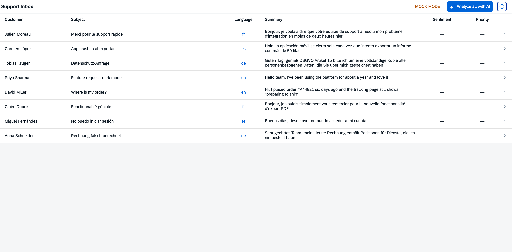

# Exercise 2 — Summarizer + LanguageDetector (manual track)

**Time:** 10 minutes. **Ends with:** clicking **Analyze all with AI** on the list gives each
row a language chip and a one-line summary. On the detail page, **Analyze** does the same
for one ticket.

## Goal

Wire the first two Chrome AI calls from the controllers into the UI. `ai.summarize()` and
`ai.detectLanguage()` are already implemented in `ai.ts` (from Exercise 1) — this exercise
connects them to buttons and caches results in `ai>/results`.

Five files change:

- **`webapp/Component.ts`** — add the `results: {}` cache and bump the model size limit.
- **`webapp/controller/List.controller.ts`** — real `onAnalyzeAll` + formatters.
- **`webapp/controller/Detail.controller.ts`** — real `onAnalyze` + formatters.
- **`webapp/view/List.view.xml`** — AI cells now bind to `ai>/results` via formatters.
- **`webapp/view/Detail.view.xml`** — same for header chips + the summary panel.

## The pattern you're learning

Cache enrichment in a **shared JSONModel bag** (`ai>/results`), keyed by ticket ID, and
bind table cells to it via **formatters**. As results trickle in, the affected rows
re-render — without ever writing back to the data service.

> **Why `results`, not the OData entity?** Enrichment is view-only client state. Writing it
> back would need an OData PATCH per ticket. Keeping it client-side means the same code
> runs against mock, anonymous, or real backends unchanged.

---

## Step 1 — Add the results cache to `Component.ts`

> **File:** `webapp/Component.ts` — _apply this change_

```diff
diff --git a/webapp/Component.ts b/webapp/Component.ts
index dae1fa6..e221a90 100644
--- a/webapp/Component.ts
+++ b/webapp/Component.ts
@@ -27,8 +27,11 @@ export default class Component extends UIComponent {
             languageModel: "unknown",
             downloadPct: 0,
             busy: false,
-            mock: new URLSearchParams(location.search).has("mock")
+            mock: new URLSearchParams(location.search).has("mock"),
+            // Enrichment cache: results[ticketId] = { language, summary, sentiment, category, priority }
+            results: {}
         });
+        oAiModel.setSizeLimit(1000);
         this.setModel(oAiModel, "ai");
 
         // Kick off routing after models are attached
```

<details>
<summary>Full <code>webapp/Component.ts</code> after this change — copy this if you get lost</summary>

```typescript
import UIComponent from "sap/ui/core/UIComponent";
import JSONModel from "sap/ui/model/json/JSONModel";
import Device from "sap/ui/Device";

/**
 * @namespace workshop.ticket
 */
export default class Component extends UIComponent {
    public static metadata = {
        manifest: "json",
        interfaces: ["sap.ui.core.IAsyncContentCreation"]
    };

    public init(): void {
        super.init();

        // Device model for responsive behaviour
        const oDeviceModel = new JSONModel(Device);
        oDeviceModel.setDefaultBindingMode("OneWay");
        this.setModel(oDeviceModel, "device");

        // AI status model — mirrors the state exposed by ai.ts
        const oAiModel = new JSONModel({
            summarizer: "unknown",
            translator: "unknown",
            languageDetector: "unknown",
            languageModel: "unknown",
            downloadPct: 0,
            busy: false,
            mock: new URLSearchParams(location.search).has("mock"),
            // Enrichment cache: results[ticketId] = { language, summary, sentiment, category, priority }
            results: {}
        });
        oAiModel.setSizeLimit(1000);
        this.setModel(oAiModel, "ai");

        // Kick off routing after models are attached
        this.getRouter().initialize();
    }
}
```

</details>

> `setSizeLimit(1000)` lifts the JSONModel's default 100-item aggregation cap — otherwise a
> large `results` bag could silently truncate bound aggregations.

## Step 2 — Wire `onAnalyzeAll` + formatters on the List controller

> **File:** `webapp/controller/List.controller.ts` — _apply this change_

```diff
diff --git a/webapp/controller/List.controller.ts b/webapp/controller/List.controller.ts
index 9aee216..acb68c0 100644
--- a/webapp/controller/List.controller.ts
+++ b/webapp/controller/List.controller.ts
@@ -7,10 +7,9 @@ import { ai } from "../model/ai";
 /**
  * List Report — the support inbox.
  *
- * exercise-1: table has AI columns wired to the data model but not
- * populated yet. Buttons trigger a "not wired yet" toast. onInit probes
- * the Chrome AI status and stores it in the shared `ai` JSONModel so the
- * header chip stays accurate.
+ * exercise-2: onAnalyzeAll now iterates the visible tickets and
+ * calls the Summarizer + LanguageDetector APIs. Results land in the shared
+ * `ai>/results/<ID>` bag which the table cells bind to via formatters.
  *
  * @namespace workshop.ticket.controller
  */
@@ -43,10 +42,62 @@ export default class List extends Controller {
     }
 
     /**
-     * exercise-2 fills in Summarizer + LanguageDetector.
-     * exercise-4 adds Prompt-API classification.
+     * Iterate the tickets currently in the table and run Summarizer +
+     * LanguageDetector on each. Structured classification (Prompt API) is
+     * added in exercise-4.
      */
     public async onAnalyzeAll(): Promise<void> {
-        MessageToast.show("Analyze not wired yet — see exercise-2 / exercise-4");
+        const oAiModel = (this.getOwnerComponent() as UIComponent).getModel("ai") as any;
+        const oTable = this.byId("ticketTable") as any;
+        const aItems = oTable.getItems();
+
+        oAiModel.setProperty("/busy", true);
+        try {
+            for (const oItem of aItems) {
+                const oCtx = oItem.getBindingContext();
+                if (!oCtx) continue;
+                const id: string = oCtx.getProperty("ID");
+                const body: string = oCtx.getProperty("body") || "";
+                if (!body || (oAiModel.getProperty("/results")[id]?.summary)) continue;
+
+                const [langs, summary] = await Promise.all([
+                    ai.detectLanguage(body).catch(() => [{ detectedLanguage: "und", confidence: 0 }]),
+                    ai.summarize(body).catch((e: Error) => `(summary failed: ${e.message})`)
+                ]);
+                const language = langs[0]?.detectedLanguage ?? "und";
+                this._setResult(oAiModel, id, { language, summary });
+            }
+            MessageToast.show("Analysis complete");
+        } finally {
+            oAiModel.setProperty("/busy", false);
+        }
+    }
+
+    private _setResult(oAiModel: any, id: string, patch: Record<string, unknown>): void {
+        const results = { ...oAiModel.getProperty("/results") };
+        results[id] = { ...(results[id] ?? {}), ...patch };
+        oAiModel.setProperty("/results", results); // new object ref → binding refresh
+    }
+
+    // ── Formatters ────────────────────────────────────────────────────────
+    public fmtLanguage(id: string, results: Record<string, any>): string {
+        return results?.[id]?.language ?? "—";
+    }
+    public fmtSummary(id: string, results: Record<string, any>): string {
+        return results?.[id]?.summary ?? "";
+    }
+    public fmtSentiment(id: string, results: Record<string, any>): string {
+        return results?.[id]?.sentiment ?? "—";
+    }
+    public fmtSentimentState(id: string, results: Record<string, any>): string {
+        const s = results?.[id]?.sentiment;
+        return s === "positive" ? "Success" : s === "negative" ? "Error" : s === "neutral" ? "Information" : "None";
+    }
+    public fmtPriority(id: string, results: Record<string, any>): string {
+        return results?.[id]?.priority ?? "—";
+    }
+    public fmtPriorityState(id: string, results: Record<string, any>): string {
+        const p = results?.[id]?.priority;
+        return p === "high" ? "Error" : p === "medium" ? "Warning" : p === "low" ? "Success" : "None";
     }
 }
```

<details>
<summary>Full <code>webapp/controller/List.controller.ts</code> after this change — copy this if you get lost</summary>

```typescript
import Controller from "sap/ui/core/mvc/Controller";
import UIComponent from "sap/ui/core/UIComponent";
import Event from "sap/ui/base/Event";
import MessageToast from "sap/m/MessageToast";
import { ai } from "../model/ai";

/**
 * List Report — the support inbox.
 *
 * exercise-2: onAnalyzeAll now iterates the visible tickets and
 * calls the Summarizer + LanguageDetector APIs. Results land in the shared
 * `ai>/results/<ID>` bag which the table cells bind to via formatters.
 *
 * @namespace workshop.ticket.controller
 */
export default class List extends Controller {

    public onInit(): void {
        void this._probeAiStatus();
    }

    private async _probeAiStatus(): Promise<void> {
        const oAiModel = (this.getOwnerComponent() as UIComponent).getModel("ai") as any;
        const status = await ai.status();
        oAiModel.setProperty("/summarizer", status.summarizer);
        oAiModel.setProperty("/translator", status.translator);
        oAiModel.setProperty("/languageDetector", status.languageDetector);
        oAiModel.setProperty("/languageModel", status.languageModel);
    }

    public onOpenDetail(oEvent: Event): void {
        const oItem = oEvent.getSource() as any;
        const oContext = oItem.getBindingContext();
        if (!oContext) return;
        const sKey = encodeURIComponent(oContext.getProperty("ID"));
        (this.getOwnerComponent() as UIComponent).getRouter().navTo("detail", { key: sKey });
    }

    public onRefresh(): void {
        const oBinding = (this.byId("ticketTable") as any).getBinding("items");
        oBinding?.refresh();
    }

    /**
     * Iterate the tickets currently in the table and run Summarizer +
     * LanguageDetector on each. Structured classification (Prompt API) is
     * added in exercise-4.
     */
    public async onAnalyzeAll(): Promise<void> {
        const oAiModel = (this.getOwnerComponent() as UIComponent).getModel("ai") as any;
        const oTable = this.byId("ticketTable") as any;
        const aItems = oTable.getItems();

        oAiModel.setProperty("/busy", true);
        try {
            for (const oItem of aItems) {
                const oCtx = oItem.getBindingContext();
                if (!oCtx) continue;
                const id: string = oCtx.getProperty("ID");
                const body: string = oCtx.getProperty("body") || "";
                if (!body || (oAiModel.getProperty("/results")[id]?.summary)) continue;

                const [langs, summary] = await Promise.all([
                    ai.detectLanguage(body).catch(() => [{ detectedLanguage: "und", confidence: 0 }]),
                    ai.summarize(body).catch((e: Error) => `(summary failed: ${e.message})`)
                ]);
                const language = langs[0]?.detectedLanguage ?? "und";
                this._setResult(oAiModel, id, { language, summary });
            }
            MessageToast.show("Analysis complete");
        } finally {
            oAiModel.setProperty("/busy", false);
        }
    }

    private _setResult(oAiModel: any, id: string, patch: Record<string, unknown>): void {
        const results = { ...oAiModel.getProperty("/results") };
        results[id] = { ...(results[id] ?? {}), ...patch };
        oAiModel.setProperty("/results", results); // new object ref → binding refresh
    }

    // ── Formatters ────────────────────────────────────────────────────────
    public fmtLanguage(id: string, results: Record<string, any>): string {
        return results?.[id]?.language ?? "—";
    }
    public fmtSummary(id: string, results: Record<string, any>): string {
        return results?.[id]?.summary ?? "";
    }
    public fmtSentiment(id: string, results: Record<string, any>): string {
        return results?.[id]?.sentiment ?? "—";
    }
    public fmtSentimentState(id: string, results: Record<string, any>): string {
        const s = results?.[id]?.sentiment;
        return s === "positive" ? "Success" : s === "negative" ? "Error" : s === "neutral" ? "Information" : "None";
    }
    public fmtPriority(id: string, results: Record<string, any>): string {
        return results?.[id]?.priority ?? "—";
    }
    public fmtPriorityState(id: string, results: Record<string, any>): string {
        const p = results?.[id]?.priority;
        return p === "high" ? "Error" : p === "medium" ? "Warning" : p === "low" ? "Success" : "None";
    }
}
```

</details>

Three things to note:

- **`Promise.all` runs both APIs concurrently** — detection and summarization are independent.
- **`.catch(...)` per call** — one ticket's failure doesn't abort the batch.
- **`_setResult` copies the outer object** — mutating `results[id]` in place wouldn't fire
  a binding change event; assigning a new object reference does.

## Step 3 — Wire `onAnalyze` + formatters on the Detail controller

> **File:** `webapp/controller/Detail.controller.ts` — _apply this change_

```diff
diff --git a/webapp/controller/Detail.controller.ts b/webapp/controller/Detail.controller.ts
index d4b0d1f..a58881c 100644
--- a/webapp/controller/Detail.controller.ts
+++ b/webapp/controller/Detail.controller.ts
@@ -3,13 +3,13 @@ import UIComponent from "sap/ui/core/UIComponent";
 import JSONModel from "sap/ui/model/json/JSONModel";
 import MessageToast from "sap/m/MessageToast";
 import type Route from "sap/ui/core/routing/Route";
+import { ai } from "../model/ai";
 
 /**
- * Object Page — a single ticket.
+ * Object Page — a single ticket with translate / analyze / draft-reply actions.
  *
- * exercise-1: header + panels are wired to the data model, action
- * buttons exist but their handlers just toast "not wired yet". A local
- * `detail` JSONModel holds view-only state (showing translation, drafted reply).
+ * exercise-2: onAnalyze fills the summary + language for this
+ * ticket. Translation and structured classification arrive in later exercises.
  *
  * @namespace workshop.ticket.controller
  */
@@ -32,7 +32,7 @@ export default class Detail extends Controller {
         this.getView()?.bindElement({
             path: `/Tickets(ID=${key},IsActiveEntity=true)`,
             parameters: {
-                $select: "ID,subject,body,customer,submitted,detectedLanguage,summary,sentiment,category,priority"
+                $select: "ID,subject,body,customer,submitted"
             }
         });
         this._detailModel.setData({ showingTranslation: false, translatedBody: "", draftedReply: "" });
@@ -49,13 +49,67 @@ export default class Detail extends Controller {
         MessageToast.show("Translation not wired yet — see exercise-3");
     }
 
-    /** exercise-2 wires Summarizer + LanguageDetector; exercise-4 adds Prompt classify */
+    /**
+     * Run Summarizer + LanguageDetector for this ticket and store the result
+     * in the shared `ai>/results/<ID>` bag. exercise-4 adds Prompt-API
+     * structured classification here.
+     */
     public async onAnalyze(): Promise<void> {
-        MessageToast.show("Analyze not wired yet — see exercises 2 & 4");
+        const oCtx = this.getView()?.getBindingContext();
+        if (!oCtx) return;
+        const id: string = oCtx.getProperty("ID");
+        const body: string = oCtx.getProperty("body");
+        const oAiModel = (this.getOwnerComponent() as UIComponent).getModel("ai") as any;
+
+        oAiModel.setProperty("/busy", true);
+        try {
+            const [langs, summary] = await Promise.all([
+                ai.detectLanguage(body),
+                ai.summarize(body)
+            ]);
+            const results = { ...oAiModel.getProperty("/results") };
+            results[id] = {
+                ...(results[id] ?? {}),
+                language: langs[0]?.detectedLanguage ?? "und",
+                summary
+            };
+            oAiModel.setProperty("/results", results);
+            MessageToast.show("Analyzed");
+        } catch (err) {
+            MessageToast.show(`Analyze failed: ${(err as Error).message}`);
+        } finally {
+            oAiModel.setProperty("/busy", false);
+        }
     }
 
     /** exercise-5 wires this to the Writer API (OT-gated) with Prompt fallback */
     public async onDraftReply(): Promise<void> {
         MessageToast.show("Reply drafting not wired yet — see exercise-5");
     }
+
+    // ── Formatters (same names as List.controller for consistency) ─────────
+    public fmtLanguage(id: string, results: Record<string, any>): string {
+        return results?.[id]?.language ?? "—";
+    }
+    public fmtSummaryOrHint(id: string, results: Record<string, any>): string {
+        return results?.[id]?.summary ?? "Click Analyze to generate a summary.";
+    }
+    public fmtSentiment(id: string, results: Record<string, any>): string {
+        return results?.[id]?.sentiment ?? "—";
+    }
+    public fmtSentimentState(id: string, results: Record<string, any>): string {
+        const s = results?.[id]?.sentiment;
+        return s === "positive" ? "Success" : s === "negative" ? "Error" : s === "neutral" ? "Information" : "None";
+    }
+    public fmtCategory(id: string, results: Record<string, any>): string {
+        return results?.[id]?.category ?? "—";
+    }
+    public fmtPriority(id: string, results: Record<string, any>): string {
+        return results?.[id]?.priority ?? "—";
+    }
+    public fmtPriorityState(id: string, results: Record<string, any>): string {
+        const p = results?.[id]?.priority;
+        return p === "high" ? "Error" : p === "medium" ? "Warning" : p === "low" ? "Success" : "None";
+    }
 }
+
```

<details>
<summary>Full <code>webapp/controller/Detail.controller.ts</code> after this change — copy this if you get lost</summary>

```typescript
import Controller from "sap/ui/core/mvc/Controller";
import UIComponent from "sap/ui/core/UIComponent";
import JSONModel from "sap/ui/model/json/JSONModel";
import MessageToast from "sap/m/MessageToast";
import type Route from "sap/ui/core/routing/Route";
import { ai } from "../model/ai";

/**
 * Object Page — a single ticket with translate / analyze / draft-reply actions.
 *
 * exercise-2: onAnalyze fills the summary + language for this
 * ticket. Translation and structured classification arrive in later exercises.
 *
 * @namespace workshop.ticket.controller
 */
export default class Detail extends Controller {

    private _detailModel = new JSONModel({
        showingTranslation: false,
        translatedBody: "",
        draftedReply: ""
    });

    public onInit(): void {
        this.getView()?.setModel(this._detailModel, "detail");
        const oRouter = (this.getOwnerComponent() as UIComponent).getRouter();
        (oRouter.getRoute("detail") as Route).attachPatternMatched(this._onRouteMatched, this);
    }

    private _onRouteMatched(oEvent: any): void {
        const key = decodeURIComponent(oEvent.getParameter("arguments").key);
        this.getView()?.bindElement({
            path: `/Tickets(ID=${key},IsActiveEntity=true)`,
            parameters: {
                $select: "ID,subject,body,customer,submitted"
            }
        });
        this._detailModel.setData({ showingTranslation: false, translatedBody: "", draftedReply: "" });
    }

    public onBack(): void {
        window.history.length > 1
            ? window.history.back()
            : (this.getOwnerComponent() as UIComponent).getRouter().navTo("list", {}, true);
    }

    /** exercise-3 wires this to the Translator API */
    public async onToggleTranslation(): Promise<void> {
        MessageToast.show("Translation not wired yet — see exercise-3");
    }

    /**
     * Run Summarizer + LanguageDetector for this ticket and store the result
     * in the shared `ai>/results/<ID>` bag. exercise-4 adds Prompt-API
     * structured classification here.
     */
    public async onAnalyze(): Promise<void> {
        const oCtx = this.getView()?.getBindingContext();
        if (!oCtx) return;
        const id: string = oCtx.getProperty("ID");
        const body: string = oCtx.getProperty("body");
        const oAiModel = (this.getOwnerComponent() as UIComponent).getModel("ai") as any;

        oAiModel.setProperty("/busy", true);
        try {
            const [langs, summary] = await Promise.all([
                ai.detectLanguage(body),
                ai.summarize(body)
            ]);
            const results = { ...oAiModel.getProperty("/results") };
            results[id] = {
                ...(results[id] ?? {}),
                language: langs[0]?.detectedLanguage ?? "und",
                summary
            };
            oAiModel.setProperty("/results", results);
            MessageToast.show("Analyzed");
        } catch (err) {
            MessageToast.show(`Analyze failed: ${(err as Error).message}`);
        } finally {
            oAiModel.setProperty("/busy", false);
        }
    }

    /** exercise-5 wires this to the Writer API (OT-gated) with Prompt fallback */
    public async onDraftReply(): Promise<void> {
        MessageToast.show("Reply drafting not wired yet — see exercise-5");
    }

    // ── Formatters (same names as List.controller for consistency) ─────────
    public fmtLanguage(id: string, results: Record<string, any>): string {
        return results?.[id]?.language ?? "—";
    }
    public fmtSummaryOrHint(id: string, results: Record<string, any>): string {
        return results?.[id]?.summary ?? "Click Analyze to generate a summary.";
    }
    public fmtSentiment(id: string, results: Record<string, any>): string {
        return results?.[id]?.sentiment ?? "—";
    }
    public fmtSentimentState(id: string, results: Record<string, any>): string {
        const s = results?.[id]?.sentiment;
        return s === "positive" ? "Success" : s === "negative" ? "Error" : s === "neutral" ? "Information" : "None";
    }
    public fmtCategory(id: string, results: Record<string, any>): string {
        return results?.[id]?.category ?? "—";
    }
    public fmtPriority(id: string, results: Record<string, any>): string {
        return results?.[id]?.priority ?? "—";
    }
    public fmtPriorityState(id: string, results: Record<string, any>): string {
        const p = results?.[id]?.priority;
        return p === "high" ? "Error" : p === "medium" ? "Warning" : p === "low" ? "Success" : "None";
    }
}
```

</details>

## Step 4 — Rebind the List view cells to `ai>/results`

The four AI cells switch from `{detectedLanguage}` (empty OData field) to a formatter that
reads the results bag, keyed by the row's `ID`.

> **File:** `webapp/view/List.view.xml` — _apply this change_

```diff
diff --git a/webapp/view/List.view.xml b/webapp/view/List.view.xml
index 5e6af1c..ab2154d 100644
--- a/webapp/view/List.view.xml
+++ b/webapp/view/List.view.xml
@@ -57,15 +57,17 @@
                             <Text text="{customer}"/>
                             <Text text="{subject}"/>
                             <ObjectStatus
-                                text="{= ${detectedLanguage} || '—' }"
-                                state="{= ${detectedLanguage} ? 'Information' : 'None' }"/>
-                            <Text text="{= ${summary} || '' }" maxLines="2"/>
+                                text="{parts:[{path:'ID'},{path:'ai>/results'}], formatter:'.fmtLanguage'}"
+                                state="Information"/>
+                            <Text
+                                maxLines="2"
+                                text="{parts:[{path:'ID'},{path:'ai>/results'}], formatter:'.fmtSummary'}"/>
                             <ObjectStatus
-                                text="{= ${sentiment} || '—' }"
-                                state="{= ${sentiment} === 'positive' ? 'Success' : (${sentiment} === 'negative' ? 'Error' : (${sentiment} === 'neutral' ? 'Information' : 'None')) }"/>
+                                text="{parts:[{path:'ID'},{path:'ai>/results'}], formatter:'.fmtSentiment'}"
+                                state="{parts:[{path:'ID'},{path:'ai>/results'}], formatter:'.fmtSentimentState'}"/>
                             <ObjectStatus
-                                text="{= ${priority} || '—' }"
-                                state="{= ${priority} === 'high' ? 'Error' : (${priority} === 'medium' ? 'Warning' : (${priority} === 'low' ? 'Success' : 'None')) }"/>
+                                text="{parts:[{path:'ID'},{path:'ai>/results'}], formatter:'.fmtPriority'}"
+                                state="{parts:[{path:'ID'},{path:'ai>/results'}], formatter:'.fmtPriorityState'}"/>
                         </cells>
                     </ColumnListItem>
                 </items>
```

<details>
<summary>Full <code>webapp/view/List.view.xml</code> after this change — copy this if you get lost</summary>

```xml
<mvc:View
    controllerName="workshop.ticket.controller.List"
    xmlns:mvc="sap.ui.core.mvc"
    xmlns:core="sap.ui.core"
    xmlns:f="sap.f"
    xmlns="sap.m">

    <Page
        id="listPage"
        title="{i18n>listTitle}"
        showNavButton="false">

        <headerContent>
            <ObjectStatus
                text="{= ${ai>/mock} ? 'MOCK MODE' : ${ai>/summarizer} }"
                state="{= ${ai>/mock} ? 'Warning' : (${ai>/summarizer} === 'available' ? 'Success' : 'Error') }"
                class="sapUiSmallMarginEnd"/>
            <Button
                id="btnAnalyzeAll"
                text="{i18n>button.analyzeAll}"
                type="Emphasized"
                icon="sap-icon://ai"
                press=".onAnalyzeAll"
                enabled="{= !${ai>/busy} }"/>
            <Button
                icon="sap-icon://refresh"
                tooltip="{i18n>button.refresh}"
                press=".onRefresh"/>
        </headerContent>

        <content>
            <Table
                id="ticketTable"
                items="{
                    path: '/Tickets',
                    parameters: {
                        $select: 'ID,subject,customer,body,submitted,detectedLanguage,summary,sentiment,category,priority',
                        $orderby: 'submitted desc'
                    }
                }"
                growing="true"
                growingThreshold="20"
                mode="None">

                <columns>
                    <Column width="14rem"><Text text="{i18n>column.customer}"/></Column>
                    <Column><Text text="{i18n>column.subject}"/></Column>
                    <Column width="8rem" hAlign="Center"><Text text="{i18n>column.language}"/></Column>
                    <Column><Text text="{i18n>column.summary}"/></Column>
                    <Column width="10rem" hAlign="Center"><Text text="{i18n>column.sentiment}"/></Column>
                    <Column width="7rem" hAlign="Center"><Text text="{i18n>column.priority}"/></Column>
                </columns>

                <items>
                    <ColumnListItem type="Navigation" press=".onOpenDetail">
                        <cells>
                            <Text text="{customer}"/>
                            <Text text="{subject}"/>
                            <ObjectStatus
                                text="{parts:[{path:'ID'},{path:'ai>/results'}], formatter:'.fmtLanguage'}"
                                state="Information"/>
                            <Text
                                maxLines="2"
                                text="{parts:[{path:'ID'},{path:'ai>/results'}], formatter:'.fmtSummary'}"/>
                            <ObjectStatus
                                text="{parts:[{path:'ID'},{path:'ai>/results'}], formatter:'.fmtSentiment'}"
                                state="{parts:[{path:'ID'},{path:'ai>/results'}], formatter:'.fmtSentimentState'}"/>
                            <ObjectStatus
                                text="{parts:[{path:'ID'},{path:'ai>/results'}], formatter:'.fmtPriority'}"
                                state="{parts:[{path:'ID'},{path:'ai>/results'}], formatter:'.fmtPriorityState'}"/>
                        </cells>
                    </ColumnListItem>
                </items>
            </Table>
        </content>
    </Page>
</mvc:View>
```

</details>

> **How the formatter binding works:** `parts:[{path:'ID'},{path:'ai>/results'}]` feeds two
> arguments into `.fmtLanguage(id, results)`. When `ai>/results` is reassigned (new object
> ref), every cell using it re-evaluates. `ID` comes from the row's OData context; `results`
> from the shared model.

## Step 5 — Rebind the Detail view chips + summary panel

> **File:** `webapp/view/Detail.view.xml` — _apply this change_

```diff
diff --git a/webapp/view/Detail.view.xml b/webapp/view/Detail.view.xml
index 9e63e97..1c57fec 100644
--- a/webapp/view/Detail.view.xml
+++ b/webapp/view/Detail.view.xml
@@ -49,23 +49,26 @@
                 <HBox wrap="Wrap" alignItems="Center" class="sapUiSmallMargin">
                     <VBox class="sapUiSmallMarginEnd">
                         <Label text="{i18n>detail.language}" design="Bold"/>
-                        <ObjectStatus text="{= ${detectedLanguage} || '—' }" state="Information"/>
+                        <ObjectStatus
+                            text="{parts:[{path:'ID'},{path:'ai>/results'}], formatter:'.fmtLanguage'}"
+                            state="Information"/>
                     </VBox>
                     <VBox class="sapUiSmallMarginEnd">
                         <Label text="{i18n>detail.sentiment}" design="Bold"/>
                         <ObjectStatus
-                            text="{= ${sentiment} || '—' }"
-                            state="{= ${sentiment} === 'positive' ? 'Success' : (${sentiment} === 'negative' ? 'Error' : (${sentiment} === 'neutral' ? 'Information' : 'None')) }"/>
+                            text="{parts:[{path:'ID'},{path:'ai>/results'}], formatter:'.fmtSentiment'}"
+                            state="{parts:[{path:'ID'},{path:'ai>/results'}], formatter:'.fmtSentimentState'}"/>
                     </VBox>
                     <VBox class="sapUiSmallMarginEnd">
                         <Label text="{i18n>detail.category}" design="Bold"/>
-                        <ObjectStatus text="{= ${category} || '—' }"/>
+                        <ObjectStatus
+                            text="{parts:[{path:'ID'},{path:'ai>/results'}], formatter:'.fmtCategory'}"/>
                     </VBox>
                     <VBox class="sapUiSmallMarginEnd">
                         <Label text="{i18n>detail.priority}" design="Bold"/>
                         <ObjectStatus
-                            text="{= ${priority} || '—' }"
-                            state="{= ${priority} === 'high' ? 'Error' : (${priority} === 'medium' ? 'Warning' : (${priority} === 'low' ? 'Success' : 'None')) }"/>
+                            text="{parts:[{path:'ID'},{path:'ai>/results'}], formatter:'.fmtPriority'}"
+                            state="{parts:[{path:'ID'},{path:'ai>/results'}], formatter:'.fmtPriorityState'}"/>
                     </VBox>
                 </HBox>
             </f:DynamicPageHeader>
@@ -74,7 +77,9 @@
         <f:content>
             <VBox class="sapUiMediumMargin">
                 <Panel headerText="{i18n>detail.summary}" expandable="false" backgroundDesign="Solid">
-                    <Text text="{= ${summary} || 'Click Analyze to generate a summary.' }" class="sapUiSmallMargin"/>
+                    <Text
+                        text="{parts:[{path:'ID'},{path:'ai>/results'}], formatter:'.fmtSummaryOrHint'}"
+                        class="sapUiSmallMargin"/>
                 </Panel>
 
                 <Panel
```

<details>
<summary>Full <code>webapp/view/Detail.view.xml</code> after this change — copy this if you get lost</summary>

```xml
<mvc:View
    controllerName="workshop.ticket.controller.Detail"
    xmlns:mvc="sap.ui.core.mvc"
    xmlns:f="sap.f"
    xmlns="sap.m">

    <f:DynamicPage id="detailPage" toggleHeaderOnTitleClick="false">

        <f:title>
            <f:DynamicPageTitle>
                <f:heading>
                    <Title text="{subject}"/>
                </f:heading>
                <f:snappedContent>
                    <Text text="{customer}"/>
                </f:snappedContent>
                <f:expandedContent>
                    <Text text="{customer}"/>
                </f:expandedContent>
                <f:actions>
                    <Button
                        text="{= ${detail>/showingTranslation} ? ${i18n>button.showOriginal} : ${i18n>button.translate} }"
                        icon="sap-icon://translate"
                        press=".onToggleTranslation"
                        enabled="{= !${ai>/busy} }"/>
                    <Button
                        text="{i18n>button.analyze}"
                        icon="sap-icon://ai"
                        type="Emphasized"
                        press=".onAnalyze"
                        enabled="{= !${ai>/busy} }"/>
                    <Button
                        text="{i18n>button.draftReply}"
                        icon="sap-icon://compose"
                        press=".onDraftReply"
                        enabled="{= !${ai>/busy} }"/>
                </f:actions>
                <f:navigationActions>
                    <Button
                        icon="sap-icon://nav-back"
                        text="{i18n>button.back}"
                        press=".onBack"/>
                </f:navigationActions>
            </f:DynamicPageTitle>
        </f:title>

        <f:header>
            <f:DynamicPageHeader pinnable="true">
                <HBox wrap="Wrap" alignItems="Center" class="sapUiSmallMargin">
                    <VBox class="sapUiSmallMarginEnd">
                        <Label text="{i18n>detail.language}" design="Bold"/>
                        <ObjectStatus
                            text="{parts:[{path:'ID'},{path:'ai>/results'}], formatter:'.fmtLanguage'}"
                            state="Information"/>
                    </VBox>
                    <VBox class="sapUiSmallMarginEnd">
                        <Label text="{i18n>detail.sentiment}" design="Bold"/>
                        <ObjectStatus
                            text="{parts:[{path:'ID'},{path:'ai>/results'}], formatter:'.fmtSentiment'}"
                            state="{parts:[{path:'ID'},{path:'ai>/results'}], formatter:'.fmtSentimentState'}"/>
                    </VBox>
                    <VBox class="sapUiSmallMarginEnd">
                        <Label text="{i18n>detail.category}" design="Bold"/>
                        <ObjectStatus
                            text="{parts:[{path:'ID'},{path:'ai>/results'}], formatter:'.fmtCategory'}"/>
                    </VBox>
                    <VBox class="sapUiSmallMarginEnd">
                        <Label text="{i18n>detail.priority}" design="Bold"/>
                        <ObjectStatus
                            text="{parts:[{path:'ID'},{path:'ai>/results'}], formatter:'.fmtPriority'}"
                            state="{parts:[{path:'ID'},{path:'ai>/results'}], formatter:'.fmtPriorityState'}"/>
                    </VBox>
                </HBox>
            </f:DynamicPageHeader>
        </f:header>

        <f:content>
            <VBox class="sapUiMediumMargin">
                <Panel headerText="{i18n>detail.summary}" expandable="false" backgroundDesign="Solid">
                    <Text
                        text="{parts:[{path:'ID'},{path:'ai>/results'}], formatter:'.fmtSummaryOrHint'}"
                        class="sapUiSmallMargin"/>
                </Panel>

                <Panel
                    headerText="{= ${detail>/showingTranslation} ? ${i18n>detail.translated} : ${i18n>detail.body} }"
                    expandable="false"
                    class="sapUiSmallMarginTop"
                    backgroundDesign="Solid">
                    <Text text="{= ${detail>/showingTranslation} ? ${detail>/translatedBody} : ${body} }" class="sapUiSmallMargin"/>
                </Panel>

                <Panel
                    visible="{= !!${detail>/draftedReply} }"
                    headerText="{i18n>detail.reply}"
                    expandable="false"
                    class="sapUiSmallMarginTop"
                    backgroundDesign="Solid">
                    <TextArea
                        value="{detail>/draftedReply}"
                        rows="8"
                        width="100%"
                        class="sapUiSmallMargin"/>
                </Panel>
            </VBox>
        </f:content>
    </f:DynamicPage>
</mvc:View>
```

</details>

---

## Verify

Restart if needed (`npm start`), open `http://localhost:8080` (add `?mock=1` if Chrome AI
is policy-blocked):

- [ ] Click **Analyze all with AI** — rows populate with a language code and a summary line.
- [ ] With `?mock=1`, DE / ES / FR / EN show up correctly.
- [ ] Sentiment and Priority columns still show `—` (classification comes in Exercise 4).
- [ ] Click a row → Detail → **Analyze** — the Language chip and Summary panel populate.
- [ ] Navigate back — enrichment survives (the `ai` model is Component-scoped).

Inspect the cache in DevTools:

```js
sap.ui.getCore().getComponent(sap.ui.getCore().getComponents()[0]).getModel("ai").getProperty("/results")
```

---

## Gotchas

- **First real run may download ~1 GB** of the on-device model. Exercise 5 wires the
  progress bar. In `?mock=1` it's instant.
- **Idempotency here checks `?.summary`** — Exercise 4 moves it to `?.priority` once the full
  pipeline runs, so re-clicking Analyze doesn't redo finished rows.
- **The `results` map survives navigation** but not a browser reload (it's in-memory).
- **Formatter methods must be `public`** on the controller for `formatter:'.fmtX'` to resolve.

---

## What's next

The Detail page **Translate** button still toasts "not wired yet". Exercise 3 wires it —
with the English-pivot caveat.

## What you should see



*(Screenshots captured in `?mock=1` mode.)*

---

Ready? → [Exercise 3: Translator](05-translator.md)
