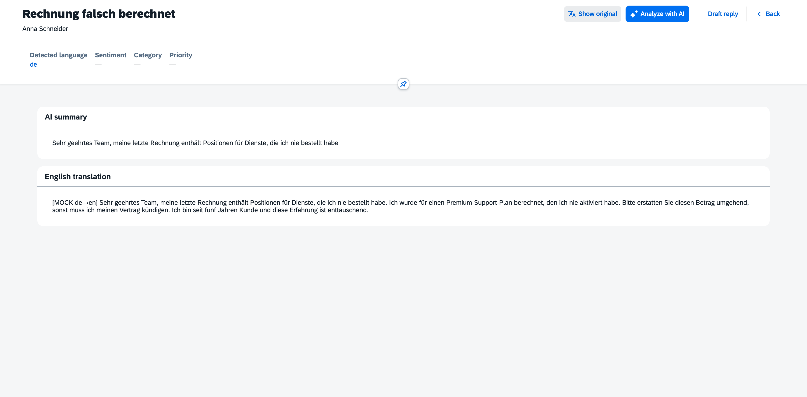

# Exercise 3 — Translator, English-pivot (manual track)

**Time:** 5 minutes. **Ends with:** clicking **Translate** on the Detail page translates a
non-English ticket to English; clicking again toggles back.

## Goal

Wire the Chrome Translator API to the Detail page's toggle button, reusing the language
detected in Exercise 2. `ai.translate()` is already implemented in `ai.ts` — this exercise
changes **one file**: `webapp/controller/Detail.controller.ts`.

## Why this matters

Translator is the API most likely to work when Summarizer / Prompt don't — it uses a
**separate model** from Gemini Nano, and enterprise policies that block "GenAI foundation
models" often still allow it.

Two gotchas baked into the shim:

1. **English pivot.** `de ↔ en` and `es ↔ en` exist; `de ↔ fr` **does not**. Cross-language
   needs two hops via English.
2. **Availability requires a language pair.** `Translator.availability()` with no args
   throws — that's why `ai.status()` probes with `{sourceLanguage:"de", targetLanguage:"en"}`.

---

## Wire the Detail controller

The only change from Exercise 2 is the body of `onToggleTranslation` (plus its doc comment).
Apply the diff below — or expand the full file if you'd rather replace it wholesale:

> **File:** `webapp/controller/Detail.controller.ts` — _apply this change_

```diff
diff --git a/webapp/controller/Detail.controller.ts b/webapp/controller/Detail.controller.ts
index a58881c..a01fb9f 100644
--- a/webapp/controller/Detail.controller.ts
+++ b/webapp/controller/Detail.controller.ts
@@ -44,9 +44,52 @@ export default class Detail extends Controller {
             : (this.getOwnerComponent() as UIComponent).getRouter().navTo("list", {}, true);
     }
 
-    /** exercise-3 wires this to the Translator API */
+    /**
+     * Toggle between showing the original message body and its English
+     * translation. First press: detect the source language, translate to
+     * English, cache in the local `detail` model. Subsequent presses just
+     * flip the visibility flag.
+     */
     public async onToggleTranslation(): Promise<void> {
-        MessageToast.show("Translation not wired yet — see exercise-3");
+        if (this._detailModel.getProperty("/showingTranslation")) {
+            this._detailModel.setProperty("/showingTranslation", false);
+            return;
+        }
+
+        // If already translated once for this ticket, reuse it
+        if (this._detailModel.getProperty("/translatedBody")) {
+            this._detailModel.setProperty("/showingTranslation", true);
+            return;
+        }
+
+        const oCtx = this.getView()?.getBindingContext();
+        if (!oCtx) return;
+        const body: string = oCtx.getProperty("body");
+        const id: string = oCtx.getProperty("ID");
+        const oAiModel = (this.getOwnerComponent() as UIComponent).getModel("ai") as any;
+
+        oAiModel.setProperty("/busy", true);
+        try {
+            // Reuse a previously-detected language if we have one, else detect now
+            let lang: string = oAiModel.getProperty("/results")[id]?.language;
+            if (!lang || lang === "und") {
+                const detected = await ai.detectLanguage(body);
+                lang = detected[0]?.detectedLanguage ?? "en";
+            }
+
+            if (lang === "en") {
+                MessageToast.show("Already in English");
+                return;
+            }
+
+            const translated = await ai.translate(body, lang, "en");
+            this._detailModel.setProperty("/translatedBody", translated);
+            this._detailModel.setProperty("/showingTranslation", true);
+        } catch (err) {
+            MessageToast.show(`Translation failed: ${(err as Error).message}`);
+        } finally {
+            oAiModel.setProperty("/busy", false);
+        }
     }
 
     /**
```

<details>
<summary>Full <code>webapp/controller/Detail.controller.ts</code> after this change — copy this if you get lost</summary>

```typescript
import Controller from "sap/ui/core/mvc/Controller";
import UIComponent from "sap/ui/core/UIComponent";
import JSONModel from "sap/ui/model/json/JSONModel";
import MessageToast from "sap/m/MessageToast";
import type Route from "sap/ui/core/routing/Route";
import { ai } from "../model/ai";

/**
 * Object Page — a single ticket with translate / analyze / draft-reply actions.
 *
 * exercise-2: onAnalyze fills the summary + language for this
 * ticket. Translation and structured classification arrive in later exercises.
 *
 * @namespace workshop.ticket.controller
 */
export default class Detail extends Controller {

    private _detailModel = new JSONModel({
        showingTranslation: false,
        translatedBody: "",
        draftedReply: ""
    });

    public onInit(): void {
        this.getView()?.setModel(this._detailModel, "detail");
        const oRouter = (this.getOwnerComponent() as UIComponent).getRouter();
        (oRouter.getRoute("detail") as Route).attachPatternMatched(this._onRouteMatched, this);
    }

    private _onRouteMatched(oEvent: any): void {
        const key = decodeURIComponent(oEvent.getParameter("arguments").key);
        this.getView()?.bindElement({
            path: `/Tickets(ID=${key},IsActiveEntity=true)`,
            parameters: {
                $select: "ID,subject,body,customer,submitted"
            }
        });
        this._detailModel.setData({ showingTranslation: false, translatedBody: "", draftedReply: "" });
    }

    public onBack(): void {
        window.history.length > 1
            ? window.history.back()
            : (this.getOwnerComponent() as UIComponent).getRouter().navTo("list", {}, true);
    }

    /**
     * Toggle between showing the original message body and its English
     * translation. First press: detect the source language, translate to
     * English, cache in the local `detail` model. Subsequent presses just
     * flip the visibility flag.
     */
    public async onToggleTranslation(): Promise<void> {
        if (this._detailModel.getProperty("/showingTranslation")) {
            this._detailModel.setProperty("/showingTranslation", false);
            return;
        }

        // If already translated once for this ticket, reuse it
        if (this._detailModel.getProperty("/translatedBody")) {
            this._detailModel.setProperty("/showingTranslation", true);
            return;
        }

        const oCtx = this.getView()?.getBindingContext();
        if (!oCtx) return;
        const body: string = oCtx.getProperty("body");
        const id: string = oCtx.getProperty("ID");
        const oAiModel = (this.getOwnerComponent() as UIComponent).getModel("ai") as any;

        oAiModel.setProperty("/busy", true);
        try {
            // Reuse a previously-detected language if we have one, else detect now
            let lang: string = oAiModel.getProperty("/results")[id]?.language;
            if (!lang || lang === "und") {
                const detected = await ai.detectLanguage(body);
                lang = detected[0]?.detectedLanguage ?? "en";
            }

            if (lang === "en") {
                MessageToast.show("Already in English");
                return;
            }

            const translated = await ai.translate(body, lang, "en");
            this._detailModel.setProperty("/translatedBody", translated);
            this._detailModel.setProperty("/showingTranslation", true);
        } catch (err) {
            MessageToast.show(`Translation failed: ${(err as Error).message}`);
        } finally {
            oAiModel.setProperty("/busy", false);
        }
    }

    /**
     * Run Summarizer + LanguageDetector for this ticket and store the result
     * in the shared `ai>/results/<ID>` bag. exercise-4 adds Prompt-API
     * structured classification here.
     */
    public async onAnalyze(): Promise<void> {
        const oCtx = this.getView()?.getBindingContext();
        if (!oCtx) return;
        const id: string = oCtx.getProperty("ID");
        const body: string = oCtx.getProperty("body");
        const oAiModel = (this.getOwnerComponent() as UIComponent).getModel("ai") as any;

        oAiModel.setProperty("/busy", true);
        try {
            const [langs, summary] = await Promise.all([
                ai.detectLanguage(body),
                ai.summarize(body)
            ]);
            const results = { ...oAiModel.getProperty("/results") };
            results[id] = {
                ...(results[id] ?? {}),
                language: langs[0]?.detectedLanguage ?? "und",
                summary
            };
            oAiModel.setProperty("/results", results);
            MessageToast.show("Analyzed");
        } catch (err) {
            MessageToast.show(`Analyze failed: ${(err as Error).message}`);
        } finally {
            oAiModel.setProperty("/busy", false);
        }
    }

    /** exercise-5 wires this to the Writer API (OT-gated) with Prompt fallback */
    public async onDraftReply(): Promise<void> {
        MessageToast.show("Reply drafting not wired yet — see exercise-5");
    }

    // ── Formatters (same names as List.controller for consistency) ─────────
    public fmtLanguage(id: string, results: Record<string, any>): string {
        return results?.[id]?.language ?? "—";
    }
    public fmtSummaryOrHint(id: string, results: Record<string, any>): string {
        return results?.[id]?.summary ?? "Click Analyze to generate a summary.";
    }
    public fmtSentiment(id: string, results: Record<string, any>): string {
        return results?.[id]?.sentiment ?? "—";
    }
    public fmtSentimentState(id: string, results: Record<string, any>): string {
        const s = results?.[id]?.sentiment;
        return s === "positive" ? "Success" : s === "negative" ? "Error" : s === "neutral" ? "Information" : "None";
    }
    public fmtCategory(id: string, results: Record<string, any>): string {
        return results?.[id]?.category ?? "—";
    }
    public fmtPriority(id: string, results: Record<string, any>): string {
        return results?.[id]?.priority ?? "—";
    }
    public fmtPriorityState(id: string, results: Record<string, any>): string {
        const p = results?.[id]?.priority;
        return p === "high" ? "Error" : p === "medium" ? "Warning" : p === "low" ? "Success" : "None";
    }
}
```

</details>

Three branches in `onToggleTranslation`:

1. **Currently showing translation** → flip back to the original (no API call).
2. **Already translated once** → re-show the cached translation (no API call).
3. **First press** → detect (or reuse the language from Analyze) → translate → cache.

**Reusing `ai>/results[id].language`** skips a redundant `detectLanguage` call if the user
already analyzed the ticket.

---

## Verify

Open a non-English ticket (Anna / Julien), then:

- [ ] **Translate to English** → the message panel shows the English translation and the
      panel title switches to "English translation".
- [ ] Click again → toggles back to the original instantly.
- [ ] Third click → instant switch to the cached translation (no spinner).

English ticket (David):

- [ ] **Translate** → toast "Already in English".

On `?mock=1`, the translation is prefixed `[MOCK de→en] …` so you can see the pivot working.

---

## Gotchas

- **English pivot:** Exercise 5 translates drafted replies `en → customer language` — the
  same two-hop pattern in reverse.
- **First translation of a pair may download ~200 MB.** Exercise 5 wires the progress bar.
- **BCP-47 tags:** if a detector returns `de-DE`, strip the region with `lang.split("-")[0]`
  before passing it to the translator. (Our detector returns bare `de`/`es`/`fr`.)

---

## What's next

Sentiment / Category / Priority chips still show `—` after Analyze. Exercise 4 chains
`ai.classify()` into the analyze handlers.

## What you should see



*(Screenshots captured in `?mock=1` mode.)*

---

Ready? → [Exercise 4: Prompt API + JSON-schema output](06-prompt-structured.md)
