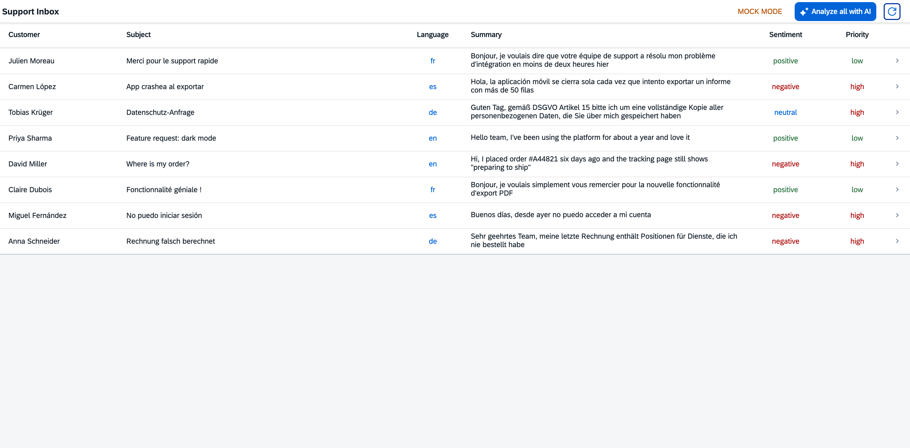

# Exercise 4 — Prompt API + JSON-schema structured output (manual track)

**Time:** 10 minutes. **Ends with:** Analyze produces valid `sentiment`, `category`,
`priority` chips on every ticket. The model is constrained by a JSON Schema — there is no
output-parsing code.

## Goal

Chain `ai.classify()` into both analyze handlers so structured metadata lands in
`ai>/results`. The Prompt API implementation with `responseConstraint` is already in
`ai.ts` (from Exercise 1). This exercise changes **two files** — the controllers only:

- **`webapp/controller/List.controller.ts`** — `onAnalyzeAll` gains translate-then-classify;
  idempotency key moves from `?.summary` to `?.priority`.
- **`webapp/controller/Detail.controller.ts`** — `onAnalyze` gains the same chain.

## Why this matters

Chrome's Prompt API takes a **JSON Schema** as `responseConstraint`. At each token the
decoder is masked to only emit valid JSON — this is **constrained decoding**, not "the
prompt asked for JSON". The schema is your API contract: `enum: ["low","medium","high"]`
means the model literally cannot output anything else.

Non-English tickets get **translated to English first** so the classifier sees consistent
input (the English pivot again).

---

## Step 1 — Extend `onAnalyzeAll` on the List controller

> **File:** `webapp/controller/List.controller.ts` — _apply this change_

```diff
diff --git a/webapp/controller/List.controller.ts b/webapp/controller/List.controller.ts
index acb68c0..f616659 100644
--- a/webapp/controller/List.controller.ts
+++ b/webapp/controller/List.controller.ts
@@ -42,9 +42,12 @@ export default class List extends Controller {
     }
 
     /**
-     * Iterate the tickets currently in the table and run Summarizer +
-     * LanguageDetector on each. Structured classification (Prompt API) is
-     * added in exercise-4.
+     * Iterate the tickets currently in the table and run three AI operations:
+     *   1. Summarizer + LanguageDetector (concurrently)
+     *   2. If not English → Translator (source → en) to feed the classifier
+     *   3. Prompt API with `responseConstraint` (JSON Schema) → {sentiment, category, priority}
+     *
+     * All results are cached in the shared `ai>/results/<ID>` bag.
      */
     public async onAnalyzeAll(): Promise<void> {
         const oAiModel = (this.getOwnerComponent() as UIComponent).getModel("ai") as any;
@@ -58,7 +61,7 @@ export default class List extends Controller {
                 if (!oCtx) continue;
                 const id: string = oCtx.getProperty("ID");
                 const body: string = oCtx.getProperty("body") || "";
-                if (!body || (oAiModel.getProperty("/results")[id]?.summary)) continue;
+                if (!body || (oAiModel.getProperty("/results")[id]?.priority)) continue;
 
                 const [langs, summary] = await Promise.all([
                     ai.detectLanguage(body).catch(() => [{ detectedLanguage: "und", confidence: 0 }]),
@@ -66,6 +69,18 @@ export default class List extends Controller {
                 ]);
                 const language = langs[0]?.detectedLanguage ?? "und";
                 this._setResult(oAiModel, id, { language, summary });
+
+                // Translate to English if needed so the classifier sees consistent input
+                const bodyEn = language === "en" || language === "und"
+                    ? body
+                    : await ai.translate(body, language, "en").catch(() => body);
+
+                const cls = await ai.classify(bodyEn).catch((e: Error) => {
+                    // eslint-disable-next-line no-console
+                    console.warn("classify failed", e);
+                    return null;
+                });
+                if (cls) this._setResult(oAiModel, id, cls);
             }
             MessageToast.show("Analysis complete");
         } finally {
```

<details>
<summary>Full <code>webapp/controller/List.controller.ts</code> after this change — copy this if you get lost</summary>

```typescript
import Controller from "sap/ui/core/mvc/Controller";
import UIComponent from "sap/ui/core/UIComponent";
import Event from "sap/ui/base/Event";
import MessageToast from "sap/m/MessageToast";
import { ai } from "../model/ai";

/**
 * List Report — the support inbox.
 *
 * exercise-2: onAnalyzeAll now iterates the visible tickets and
 * calls the Summarizer + LanguageDetector APIs. Results land in the shared
 * `ai>/results/<ID>` bag which the table cells bind to via formatters.
 *
 * @namespace workshop.ticket.controller
 */
export default class List extends Controller {

    public onInit(): void {
        void this._probeAiStatus();
    }

    private async _probeAiStatus(): Promise<void> {
        const oAiModel = (this.getOwnerComponent() as UIComponent).getModel("ai") as any;
        const status = await ai.status();
        oAiModel.setProperty("/summarizer", status.summarizer);
        oAiModel.setProperty("/translator", status.translator);
        oAiModel.setProperty("/languageDetector", status.languageDetector);
        oAiModel.setProperty("/languageModel", status.languageModel);
    }

    public onOpenDetail(oEvent: Event): void {
        const oItem = oEvent.getSource() as any;
        const oContext = oItem.getBindingContext();
        if (!oContext) return;
        const sKey = encodeURIComponent(oContext.getProperty("ID"));
        (this.getOwnerComponent() as UIComponent).getRouter().navTo("detail", { key: sKey });
    }

    public onRefresh(): void {
        const oBinding = (this.byId("ticketTable") as any).getBinding("items");
        oBinding?.refresh();
    }

    /**
     * Iterate the tickets currently in the table and run three AI operations:
     *   1. Summarizer + LanguageDetector (concurrently)
     *   2. If not English → Translator (source → en) to feed the classifier
     *   3. Prompt API with `responseConstraint` (JSON Schema) → {sentiment, category, priority}
     *
     * All results are cached in the shared `ai>/results/<ID>` bag.
     */
    public async onAnalyzeAll(): Promise<void> {
        const oAiModel = (this.getOwnerComponent() as UIComponent).getModel("ai") as any;
        const oTable = this.byId("ticketTable") as any;
        const aItems = oTable.getItems();

        oAiModel.setProperty("/busy", true);
        try {
            for (const oItem of aItems) {
                const oCtx = oItem.getBindingContext();
                if (!oCtx) continue;
                const id: string = oCtx.getProperty("ID");
                const body: string = oCtx.getProperty("body") || "";
                if (!body || (oAiModel.getProperty("/results")[id]?.priority)) continue;

                const [langs, summary] = await Promise.all([
                    ai.detectLanguage(body).catch(() => [{ detectedLanguage: "und", confidence: 0 }]),
                    ai.summarize(body).catch((e: Error) => `(summary failed: ${e.message})`)
                ]);
                const language = langs[0]?.detectedLanguage ?? "und";
                this._setResult(oAiModel, id, { language, summary });

                // Translate to English if needed so the classifier sees consistent input
                const bodyEn = language === "en" || language === "und"
                    ? body
                    : await ai.translate(body, language, "en").catch(() => body);

                const cls = await ai.classify(bodyEn).catch((e: Error) => {
                    // eslint-disable-next-line no-console
                    console.warn("classify failed", e);
                    return null;
                });
                if (cls) this._setResult(oAiModel, id, cls);
            }
            MessageToast.show("Analysis complete");
        } finally {
            oAiModel.setProperty("/busy", false);
        }
    }

    private _setResult(oAiModel: any, id: string, patch: Record<string, unknown>): void {
        const results = { ...oAiModel.getProperty("/results") };
        results[id] = { ...(results[id] ?? {}), ...patch };
        oAiModel.setProperty("/results", results); // new object ref → binding refresh
    }

    // ── Formatters ────────────────────────────────────────────────────────
    public fmtLanguage(id: string, results: Record<string, any>): string {
        return results?.[id]?.language ?? "—";
    }
    public fmtSummary(id: string, results: Record<string, any>): string {
        return results?.[id]?.summary ?? "";
    }
    public fmtSentiment(id: string, results: Record<string, any>): string {
        return results?.[id]?.sentiment ?? "—";
    }
    public fmtSentimentState(id: string, results: Record<string, any>): string {
        const s = results?.[id]?.sentiment;
        return s === "positive" ? "Success" : s === "negative" ? "Error" : s === "neutral" ? "Information" : "None";
    }
    public fmtPriority(id: string, results: Record<string, any>): string {
        return results?.[id]?.priority ?? "—";
    }
    public fmtPriorityState(id: string, results: Record<string, any>): string {
        const p = results?.[id]?.priority;
        return p === "high" ? "Error" : p === "medium" ? "Warning" : p === "low" ? "Success" : "None";
    }
}
```

</details>

Two changes from Exercise 2:

- **Idempotency key `?.priority`** (was `?.summary`) — a ticket counts as "done" only after
  the *full* pipeline, so re-running Analyze finishes partially-processed rows.
- **Translate-then-classify** after the summarize/detect block, each wrapped in `.catch()`
  so one failure doesn't abort the batch.

## Step 2 — Extend `onAnalyze` on the Detail controller

> **File:** `webapp/controller/Detail.controller.ts` — _apply this change_

```diff
diff --git a/webapp/controller/Detail.controller.ts b/webapp/controller/Detail.controller.ts
index a01fb9f..9046b4b 100644
--- a/webapp/controller/Detail.controller.ts
+++ b/webapp/controller/Detail.controller.ts
@@ -93,9 +93,9 @@ export default class Detail extends Controller {
     }
 
     /**
-     * Run Summarizer + LanguageDetector for this ticket and store the result
-     * in the shared `ai>/results/<ID>` bag. exercise-4 adds Prompt-API
-     * structured classification here.
+     * Run Summarizer + LanguageDetector for this ticket, then translate to
+     * English if needed, then classify with the Prompt API using a JSON
+     * Schema (`responseConstraint`). Result goes into `ai>/results/<ID>`.
      */
     public async onAnalyze(): Promise<void> {
         const oCtx = this.getView()?.getBindingContext();
@@ -110,11 +110,19 @@ export default class Detail extends Controller {
                 ai.detectLanguage(body),
                 ai.summarize(body)
             ]);
+            const language = langs[0]?.detectedLanguage ?? "und";
+
+            const bodyEn = language === "en" || language === "und"
+                ? body
+                : await ai.translate(body, language, "en").catch(() => body);
+            const cls = await ai.classify(bodyEn).catch(() => null);
+
             const results = { ...oAiModel.getProperty("/results") };
             results[id] = {
                 ...(results[id] ?? {}),
-                language: langs[0]?.detectedLanguage ?? "und",
-                summary
+                language,
+                summary,
+                ...(cls ?? {})
             };
             oAiModel.setProperty("/results", results);
             MessageToast.show("Analyzed");
```

<details>
<summary>Full <code>webapp/controller/Detail.controller.ts</code> after this change — copy this if you get lost</summary>

```typescript
import Controller from "sap/ui/core/mvc/Controller";
import UIComponent from "sap/ui/core/UIComponent";
import JSONModel from "sap/ui/model/json/JSONModel";
import MessageToast from "sap/m/MessageToast";
import type Route from "sap/ui/core/routing/Route";
import { ai } from "../model/ai";

/**
 * Object Page — a single ticket with translate / analyze / draft-reply actions.
 *
 * exercise-2: onAnalyze fills the summary + language for this
 * ticket. Translation and structured classification arrive in later exercises.
 *
 * @namespace workshop.ticket.controller
 */
export default class Detail extends Controller {

    private _detailModel = new JSONModel({
        showingTranslation: false,
        translatedBody: "",
        draftedReply: ""
    });

    public onInit(): void {
        this.getView()?.setModel(this._detailModel, "detail");
        const oRouter = (this.getOwnerComponent() as UIComponent).getRouter();
        (oRouter.getRoute("detail") as Route).attachPatternMatched(this._onRouteMatched, this);
    }

    private _onRouteMatched(oEvent: any): void {
        const key = decodeURIComponent(oEvent.getParameter("arguments").key);
        this.getView()?.bindElement({
            path: `/Tickets(ID=${key},IsActiveEntity=true)`,
            parameters: {
                $select: "ID,subject,body,customer,submitted"
            }
        });
        this._detailModel.setData({ showingTranslation: false, translatedBody: "", draftedReply: "" });
    }

    public onBack(): void {
        window.history.length > 1
            ? window.history.back()
            : (this.getOwnerComponent() as UIComponent).getRouter().navTo("list", {}, true);
    }

    /**
     * Toggle between showing the original message body and its English
     * translation. First press: detect the source language, translate to
     * English, cache in the local `detail` model. Subsequent presses just
     * flip the visibility flag.
     */
    public async onToggleTranslation(): Promise<void> {
        if (this._detailModel.getProperty("/showingTranslation")) {
            this._detailModel.setProperty("/showingTranslation", false);
            return;
        }

        // If already translated once for this ticket, reuse it
        if (this._detailModel.getProperty("/translatedBody")) {
            this._detailModel.setProperty("/showingTranslation", true);
            return;
        }

        const oCtx = this.getView()?.getBindingContext();
        if (!oCtx) return;
        const body: string = oCtx.getProperty("body");
        const id: string = oCtx.getProperty("ID");
        const oAiModel = (this.getOwnerComponent() as UIComponent).getModel("ai") as any;

        oAiModel.setProperty("/busy", true);
        try {
            // Reuse a previously-detected language if we have one, else detect now
            let lang: string = oAiModel.getProperty("/results")[id]?.language;
            if (!lang || lang === "und") {
                const detected = await ai.detectLanguage(body);
                lang = detected[0]?.detectedLanguage ?? "en";
            }

            if (lang === "en") {
                MessageToast.show("Already in English");
                return;
            }

            const translated = await ai.translate(body, lang, "en");
            this._detailModel.setProperty("/translatedBody", translated);
            this._detailModel.setProperty("/showingTranslation", true);
        } catch (err) {
            MessageToast.show(`Translation failed: ${(err as Error).message}`);
        } finally {
            oAiModel.setProperty("/busy", false);
        }
    }

    /**
     * Run Summarizer + LanguageDetector for this ticket, then translate to
     * English if needed, then classify with the Prompt API using a JSON
     * Schema (`responseConstraint`). Result goes into `ai>/results/<ID>`.
     */
    public async onAnalyze(): Promise<void> {
        const oCtx = this.getView()?.getBindingContext();
        if (!oCtx) return;
        const id: string = oCtx.getProperty("ID");
        const body: string = oCtx.getProperty("body");
        const oAiModel = (this.getOwnerComponent() as UIComponent).getModel("ai") as any;

        oAiModel.setProperty("/busy", true);
        try {
            const [langs, summary] = await Promise.all([
                ai.detectLanguage(body),
                ai.summarize(body)
            ]);
            const language = langs[0]?.detectedLanguage ?? "und";

            const bodyEn = language === "en" || language === "und"
                ? body
                : await ai.translate(body, language, "en").catch(() => body);
            const cls = await ai.classify(bodyEn).catch(() => null);

            const results = { ...oAiModel.getProperty("/results") };
            results[id] = {
                ...(results[id] ?? {}),
                language,
                summary,
                ...(cls ?? {})
            };
            oAiModel.setProperty("/results", results);
            MessageToast.show("Analyzed");
        } catch (err) {
            MessageToast.show(`Analyze failed: ${(err as Error).message}`);
        } finally {
            oAiModel.setProperty("/busy", false);
        }
    }

    /** exercise-5 wires this to the Writer API (OT-gated) with Prompt fallback */
    public async onDraftReply(): Promise<void> {
        MessageToast.show("Reply drafting not wired yet — see exercise-5");
    }

    // ── Formatters (same names as List.controller for consistency) ─────────
    public fmtLanguage(id: string, results: Record<string, any>): string {
        return results?.[id]?.language ?? "—";
    }
    public fmtSummaryOrHint(id: string, results: Record<string, any>): string {
        return results?.[id]?.summary ?? "Click Analyze to generate a summary.";
    }
    public fmtSentiment(id: string, results: Record<string, any>): string {
        return results?.[id]?.sentiment ?? "—";
    }
    public fmtSentimentState(id: string, results: Record<string, any>): string {
        const s = results?.[id]?.sentiment;
        return s === "positive" ? "Success" : s === "negative" ? "Error" : s === "neutral" ? "Information" : "None";
    }
    public fmtCategory(id: string, results: Record<string, any>): string {
        return results?.[id]?.category ?? "—";
    }
    public fmtPriority(id: string, results: Record<string, any>): string {
        return results?.[id]?.priority ?? "—";
    }
    public fmtPriorityState(id: string, results: Record<string, any>): string {
        const p = results?.[id]?.priority;
        return p === "high" ? "Error" : p === "medium" ? "Warning" : p === "low" ? "Success" : "None";
    }
}
```

</details>

The schema lives in `ai.ts` (`CLASSIFICATION_SCHEMA`). Because `ai.classify()` returns a
typed `TicketClassification`, spreading `...(cls ?? {})` merges `sentiment`, `category`, and
`priority` straight into the results bag — the chips light up automatically via the
formatters you already wired in Exercise 2.

---

## Verify

Click **Analyze all with AI**:

- [ ] **Sentiment** and **Priority** columns populate with colored chips.
- [ ] The Detail header shows Language, Sentiment, Category, Priority.
- [ ] Spot-check (with `?mock=1` the regex produces these deterministically):
      Anna → negative / high; Priya → positive / low; Julien → positive / low.

```js
sap.ui.getCore().getComponent(sap.ui.getCore().getComponents()[0]).getModel("ai").getProperty("/results")
```

---

## Gotchas

- **`responseConstraint` needs valid inline JSON Schema** — most builds don't support `$ref`.
- **English-pivot matters** — skip the translate step and German/Spanish tickets classify
  worse, because the classifier's system prompt and examples are English.
- **Wrap `classify` in `.catch(() => null)`** at the call site — a classify failure should
  leave the summary/language already stored, not blow up the whole handler.
- **First `LanguageModel.create()` may take 5–10 s** to warm up; the session is cached in
  `ai.ts` so subsequent calls are fast.

---

## What's next

**Draft reply** is still stubbed. Exercise 5 wires it — plus download-progress UX (busy
text, progress bar, i18n stage labels) across every AI action.

## What you should see



*(Screenshots captured in `?mock=1` mode.)*

---

Ready? → [Exercise 5: Writer API + graceful degradation](07-writer-fallback.md)
