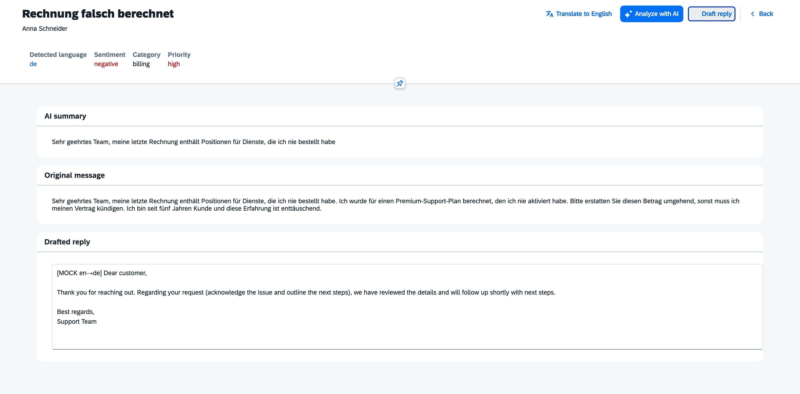

# Exercise 5 — Writer API + graceful degradation (manual track)

**Time:** 10 minutes. **Ends with:** the finished app. Click **Draft reply** and a support
reply appears in the customer's language. First-run model downloads show a progress bar and
a stage label.

## Goal

1. Wire **Draft reply** via `ai.draftReply()` (Writer → Prompt fallback, already in `ai.ts`).
2. Add **download-progress UX** across all AI actions: a `busyText` stage label, a
   `progress` bar, and i18n stage strings.

This is the largest controller exercise — **six files change**:

| File | What changes |
|---|---|
| `webapp/Component.ts` | add `busyText` + `progress` to the `ai` model |
| `webapp/i18n/i18n.properties` | add `ai.busy.*` stage labels |
| `webapp/view/List.view.xml` | busy text + progress bar in the header; table busy overlay |
| `webapp/view/Detail.view.xml` | same in the DynamicPage actions; page busy overlay |
| `webapp/controller/List.controller.ts` | progress hooks + stage labels in `onAnalyzeAll` |
| `webapp/controller/Detail.controller.ts` | `_aiUx()` helper; wire all handlers + `onDraftReply` |

## Why this matters

**Graceful degradation:** Writer is Origin Trial in Chrome 148. `ai.draftReply()` tries
Writer first and falls back to the Prompt API — so the feature works wherever the Prompt API
works, token or no token.

**Progress UX:** the first `create()` on a fresh profile downloads a model. The
`AiHooks.onProgress` callback (in `ai.ts` since Exercise 1) is finally wired here so users
see *what* is happening and *how far* the download has got.

---

## Step 1 — Add `busyText` + `progress` to `Component.ts`

> **File:** `webapp/Component.ts` — _apply this change_

```diff
diff --git a/webapp/Component.ts b/webapp/Component.ts
index e221a90..262cd5e 100644
--- a/webapp/Component.ts
+++ b/webapp/Component.ts
@@ -27,6 +27,10 @@ export default class Component extends UIComponent {
             languageModel: "unknown",
             downloadPct: 0,
             busy: false,
+            // Human-readable label for the current AI stage (e.g. "Summarizing 3 / 8")
+            busyText: "",
+            // 0..1 progress from Chrome model downloads (monitor.downloadprogress)
+            progress: 0,
             mock: new URLSearchParams(location.search).has("mock"),
             // Enrichment cache: results[ticketId] = { language, summary, sentiment, category, priority }
             results: {}
```

<details>
<summary>Full <code>webapp/Component.ts</code> after this change — copy this if you get lost</summary>

```typescript
import UIComponent from "sap/ui/core/UIComponent";
import JSONModel from "sap/ui/model/json/JSONModel";
import Device from "sap/ui/Device";

/**
 * @namespace workshop.ticket
 */
export default class Component extends UIComponent {
    public static metadata = {
        manifest: "json",
        interfaces: ["sap.ui.core.IAsyncContentCreation"]
    };

    public init(): void {
        super.init();

        // Device model for responsive behaviour
        const oDeviceModel = new JSONModel(Device);
        oDeviceModel.setDefaultBindingMode("OneWay");
        this.setModel(oDeviceModel, "device");

        // AI status model — mirrors the state exposed by ai.ts
        const oAiModel = new JSONModel({
            summarizer: "unknown",
            translator: "unknown",
            languageDetector: "unknown",
            languageModel: "unknown",
            downloadPct: 0,
            busy: false,
            // Human-readable label for the current AI stage (e.g. "Summarizing 3 / 8")
            busyText: "",
            // 0..1 progress from Chrome model downloads (monitor.downloadprogress)
            progress: 0,
            mock: new URLSearchParams(location.search).has("mock"),
            // Enrichment cache: results[ticketId] = { language, summary, sentiment, category, priority }
            results: {}
        });
        oAiModel.setSizeLimit(1000);
        this.setModel(oAiModel, "ai");

        // Kick off routing after models are attached
        this.getRouter().initialize();
    }
}
```

</details>

## Step 2 — Add stage labels to i18n

> **File:** `webapp/i18n/i18n.properties` — _apply this change_

```diff
diff --git a/webapp/i18n/i18n.properties b/webapp/i18n/i18n.properties
index fcb1365..b73f750 100644
--- a/webapp/i18n/i18n.properties
+++ b/webapp/i18n/i18n.properties
@@ -16,6 +16,12 @@ ai.status.downloadable=AI model needs download
 ai.status.downloading=AI model downloading…
 ai.status.unavailable=AI not available (use ?mock=1)
 ai.progress=Downloading model: {0}%
+ai.busy.detecting=Detecting language…
+ai.busy.summarizing=Summarizing…
+ai.busy.translating=Translating…
+ai.busy.classifying=Classifying…
+ai.busy.drafting=Drafting reply…
+ai.busy.analyzing=Analyzing {0} / {1}
 
 # Detail view
 detail.body=Original message
```

<details>
<summary>Full <code>webapp/i18n/i18n.properties</code> after this change — copy this if you get lost</summary>

```properties
appTitle=Support Inbox
appDescription=Chrome AI-powered multilingual support triage

# List view
listTitle=Support Inbox
column.customer=Customer
column.subject=Subject
column.language=Language
column.summary=Summary
column.sentiment=Sentiment
column.priority=Priority
button.analyzeAll=Analyze all with AI
button.refresh=Refresh
ai.status.available=AI ready
ai.status.downloadable=AI model needs download
ai.status.downloading=AI model downloading…
ai.status.unavailable=AI not available (use ?mock=1)
ai.progress=Downloading model: {0}%
ai.busy.detecting=Detecting language…
ai.busy.summarizing=Summarizing…
ai.busy.translating=Translating…
ai.busy.classifying=Classifying…
ai.busy.drafting=Drafting reply…
ai.busy.analyzing=Analyzing {0} / {1}

# Detail view
detail.body=Original message
detail.translated=English translation
detail.summary=AI summary
detail.language=Detected language
detail.sentiment=Sentiment
detail.category=Category
detail.priority=Priority
detail.reply=Drafted reply
button.translate=Translate to English
button.showOriginal=Show original
button.analyze=Analyze with AI
button.draftReply=Draft reply
button.back=Back
```

</details>

## Step 3 — Add progress UI to the List view

The header gains a busy-text label and a `ProgressIndicator` (visible only while a download
is mid-flight), and the table gets a busy overlay.

> **File:** `webapp/view/List.view.xml` — _apply this change_

```diff
diff --git a/webapp/view/List.view.xml b/webapp/view/List.view.xml
index ab2154d..bc0dd49 100644
--- a/webapp/view/List.view.xml
+++ b/webapp/view/List.view.xml
@@ -15,6 +15,18 @@
                 text="{= ${ai>/mock} ? 'MOCK MODE' : ${ai>/summarizer} }"
                 state="{= ${ai>/mock} ? 'Warning' : (${ai>/summarizer} === 'available' ? 'Success' : 'Error') }"
                 class="sapUiSmallMarginEnd"/>
+            <Text
+                visible="{= !!${ai>/busy} }"
+                text="{ai>/busyText}"
+                class="sapUiSmallMarginEnd"/>
+            <ProgressIndicator
+                visible="{= !!${ai>/busy} &amp;&amp; ${ai>/progress} &gt; 0 &amp;&amp; ${ai>/progress} &lt; 1 }"
+                percentValue="{= ${ai>/progress} * 100 }"
+                displayValue="{i18n>ai.progress}"
+                showValue="true"
+                state="Information"
+                width="14rem"
+                class="sapUiSmallMarginEnd"/>
             <Button
                 id="btnAnalyzeAll"
                 text="{i18n>button.analyzeAll}"
@@ -31,6 +43,8 @@
         <content>
             <Table
                 id="ticketTable"
+                busy="{ai>/busy}"
+                busyIndicatorDelay="0"
                 items="{
                     path: '/Tickets',
                     parameters: {
```

<details>
<summary>Full <code>webapp/view/List.view.xml</code> after this change — copy this if you get lost</summary>

```xml
<mvc:View
    controllerName="workshop.ticket.controller.List"
    xmlns:mvc="sap.ui.core.mvc"
    xmlns:core="sap.ui.core"
    xmlns:f="sap.f"
    xmlns="sap.m">

    <Page
        id="listPage"
        title="{i18n>listTitle}"
        showNavButton="false">

        <headerContent>
            <ObjectStatus
                text="{= ${ai>/mock} ? 'MOCK MODE' : ${ai>/summarizer} }"
                state="{= ${ai>/mock} ? 'Warning' : (${ai>/summarizer} === 'available' ? 'Success' : 'Error') }"
                class="sapUiSmallMarginEnd"/>
            <Text
                visible="{= !!${ai>/busy} }"
                text="{ai>/busyText}"
                class="sapUiSmallMarginEnd"/>
            <ProgressIndicator
                visible="{= !!${ai>/busy} &amp;&amp; ${ai>/progress} &gt; 0 &amp;&amp; ${ai>/progress} &lt; 1 }"
                percentValue="{= ${ai>/progress} * 100 }"
                displayValue="{i18n>ai.progress}"
                showValue="true"
                state="Information"
                width="14rem"
                class="sapUiSmallMarginEnd"/>
            <Button
                id="btnAnalyzeAll"
                text="{i18n>button.analyzeAll}"
                type="Emphasized"
                icon="sap-icon://ai"
                press=".onAnalyzeAll"
                enabled="{= !${ai>/busy} }"/>
            <Button
                icon="sap-icon://refresh"
                tooltip="{i18n>button.refresh}"
                press=".onRefresh"/>
        </headerContent>

        <content>
            <Table
                id="ticketTable"
                busy="{ai>/busy}"
                busyIndicatorDelay="0"
                items="{
                    path: '/Tickets',
                    parameters: {
                        $select: 'ID,subject,customer,body,submitted,detectedLanguage,summary,sentiment,category,priority',
                        $orderby: 'submitted desc'
                    }
                }"
                growing="true"
                growingThreshold="20"
                mode="None">

                <columns>
                    <Column width="14rem"><Text text="{i18n>column.customer}"/></Column>
                    <Column><Text text="{i18n>column.subject}"/></Column>
                    <Column width="8rem" hAlign="Center"><Text text="{i18n>column.language}"/></Column>
                    <Column><Text text="{i18n>column.summary}"/></Column>
                    <Column width="10rem" hAlign="Center"><Text text="{i18n>column.sentiment}"/></Column>
                    <Column width="7rem" hAlign="Center"><Text text="{i18n>column.priority}"/></Column>
                </columns>

                <items>
                    <ColumnListItem type="Navigation" press=".onOpenDetail">
                        <cells>
                            <Text text="{customer}"/>
                            <Text text="{subject}"/>
                            <ObjectStatus
                                text="{parts:[{path:'ID'},{path:'ai>/results'}], formatter:'.fmtLanguage'}"
                                state="Information"/>
                            <Text
                                maxLines="2"
                                text="{parts:[{path:'ID'},{path:'ai>/results'}], formatter:'.fmtSummary'}"/>
                            <ObjectStatus
                                text="{parts:[{path:'ID'},{path:'ai>/results'}], formatter:'.fmtSentiment'}"
                                state="{parts:[{path:'ID'},{path:'ai>/results'}], formatter:'.fmtSentimentState'}"/>
                            <ObjectStatus
                                text="{parts:[{path:'ID'},{path:'ai>/results'}], formatter:'.fmtPriority'}"
                                state="{parts:[{path:'ID'},{path:'ai>/results'}], formatter:'.fmtPriorityState'}"/>
                        </cells>
                    </ColumnListItem>
                </items>
            </Table>
        </content>
    </Page>
</mvc:View>
```

</details>

> **Note the XML-escaped operators** in the `ProgressIndicator.visible` expression:
> `&amp;&amp;` is `&&`, `&gt;` is `>`, `&lt;` is `<`. They must be escaped inside XML
> attribute values.

## Step 4 — Add progress UI to the Detail view

Same busy-text + progress bar pattern in the DynamicPage actions, plus a page-level busy
overlay.

> **File:** `webapp/view/Detail.view.xml` — _apply this change_

```diff
diff --git a/webapp/view/Detail.view.xml b/webapp/view/Detail.view.xml
index 1c57fec..9569a2a 100644
--- a/webapp/view/Detail.view.xml
+++ b/webapp/view/Detail.view.xml
@@ -4,7 +4,11 @@
     xmlns:f="sap.f"
     xmlns="sap.m">
 
-    <f:DynamicPage id="detailPage" toggleHeaderOnTitleClick="false">
+    <f:DynamicPage
+        id="detailPage"
+        toggleHeaderOnTitleClick="false"
+        busy="{ai>/busy}"
+        busyIndicatorDelay="0">
 
         <f:title>
             <f:DynamicPageTitle>
@@ -18,6 +22,18 @@
                     <Text text="{customer}"/>
                 </f:expandedContent>
                 <f:actions>
+                    <Text
+                        visible="{= !!${ai>/busy} }"
+                        text="{ai>/busyText}"
+                        class="sapUiSmallMarginEnd"/>
+                    <ProgressIndicator
+                        visible="{= !!${ai>/busy} &amp;&amp; ${ai>/progress} &gt; 0 &amp;&amp; ${ai>/progress} &lt; 1 }"
+                        percentValue="{= ${ai>/progress} * 100 }"
+                        displayValue="{i18n>ai.progress}"
+                        showValue="true"
+                        state="Information"
+                        width="12rem"
+                        class="sapUiSmallMarginEnd"/>
                     <Button
                         text="{= ${detail>/showingTranslation} ? ${i18n>button.showOriginal} : ${i18n>button.translate} }"
                         icon="sap-icon://translate"
```

<details>
<summary>Full <code>webapp/view/Detail.view.xml</code> after this change — copy this if you get lost</summary>

```xml
<mvc:View
    controllerName="workshop.ticket.controller.Detail"
    xmlns:mvc="sap.ui.core.mvc"
    xmlns:f="sap.f"
    xmlns="sap.m">

    <f:DynamicPage
        id="detailPage"
        toggleHeaderOnTitleClick="false"
        busy="{ai>/busy}"
        busyIndicatorDelay="0">

        <f:title>
            <f:DynamicPageTitle>
                <f:heading>
                    <Title text="{subject}"/>
                </f:heading>
                <f:snappedContent>
                    <Text text="{customer}"/>
                </f:snappedContent>
                <f:expandedContent>
                    <Text text="{customer}"/>
                </f:expandedContent>
                <f:actions>
                    <Text
                        visible="{= !!${ai>/busy} }"
                        text="{ai>/busyText}"
                        class="sapUiSmallMarginEnd"/>
                    <ProgressIndicator
                        visible="{= !!${ai>/busy} &amp;&amp; ${ai>/progress} &gt; 0 &amp;&amp; ${ai>/progress} &lt; 1 }"
                        percentValue="{= ${ai>/progress} * 100 }"
                        displayValue="{i18n>ai.progress}"
                        showValue="true"
                        state="Information"
                        width="12rem"
                        class="sapUiSmallMarginEnd"/>
                    <Button
                        text="{= ${detail>/showingTranslation} ? ${i18n>button.showOriginal} : ${i18n>button.translate} }"
                        icon="sap-icon://translate"
                        press=".onToggleTranslation"
                        enabled="{= !${ai>/busy} }"/>
                    <Button
                        text="{i18n>button.analyze}"
                        icon="sap-icon://ai"
                        type="Emphasized"
                        press=".onAnalyze"
                        enabled="{= !${ai>/busy} }"/>
                    <Button
                        text="{i18n>button.draftReply}"
                        icon="sap-icon://compose"
                        press=".onDraftReply"
                        enabled="{= !${ai>/busy} }"/>
                </f:actions>
                <f:navigationActions>
                    <Button
                        icon="sap-icon://nav-back"
                        text="{i18n>button.back}"
                        press=".onBack"/>
                </f:navigationActions>
            </f:DynamicPageTitle>
        </f:title>

        <f:header>
            <f:DynamicPageHeader pinnable="true">
                <HBox wrap="Wrap" alignItems="Center" class="sapUiSmallMargin">
                    <VBox class="sapUiSmallMarginEnd">
                        <Label text="{i18n>detail.language}" design="Bold"/>
                        <ObjectStatus
                            text="{parts:[{path:'ID'},{path:'ai>/results'}], formatter:'.fmtLanguage'}"
                            state="Information"/>
                    </VBox>
                    <VBox class="sapUiSmallMarginEnd">
                        <Label text="{i18n>detail.sentiment}" design="Bold"/>
                        <ObjectStatus
                            text="{parts:[{path:'ID'},{path:'ai>/results'}], formatter:'.fmtSentiment'}"
                            state="{parts:[{path:'ID'},{path:'ai>/results'}], formatter:'.fmtSentimentState'}"/>
                    </VBox>
                    <VBox class="sapUiSmallMarginEnd">
                        <Label text="{i18n>detail.category}" design="Bold"/>
                        <ObjectStatus
                            text="{parts:[{path:'ID'},{path:'ai>/results'}], formatter:'.fmtCategory'}"/>
                    </VBox>
                    <VBox class="sapUiSmallMarginEnd">
                        <Label text="{i18n>detail.priority}" design="Bold"/>
                        <ObjectStatus
                            text="{parts:[{path:'ID'},{path:'ai>/results'}], formatter:'.fmtPriority'}"
                            state="{parts:[{path:'ID'},{path:'ai>/results'}], formatter:'.fmtPriorityState'}"/>
                    </VBox>
                </HBox>
            </f:DynamicPageHeader>
        </f:header>

        <f:content>
            <VBox class="sapUiMediumMargin">
                <Panel headerText="{i18n>detail.summary}" expandable="false" backgroundDesign="Solid">
                    <Text
                        text="{parts:[{path:'ID'},{path:'ai>/results'}], formatter:'.fmtSummaryOrHint'}"
                        class="sapUiSmallMargin"/>
                </Panel>

                <Panel
                    headerText="{= ${detail>/showingTranslation} ? ${i18n>detail.translated} : ${i18n>detail.body} }"
                    expandable="false"
                    class="sapUiSmallMarginTop"
                    backgroundDesign="Solid">
                    <Text text="{= ${detail>/showingTranslation} ? ${detail>/translatedBody} : ${body} }" class="sapUiSmallMargin"/>
                </Panel>

                <Panel
                    visible="{= !!${detail>/draftedReply} }"
                    headerText="{i18n>detail.reply}"
                    expandable="false"
                    class="sapUiSmallMarginTop"
                    backgroundDesign="Solid">
                    <TextArea
                        value="{detail>/draftedReply}"
                        rows="8"
                        width="100%"
                        class="sapUiSmallMargin"/>
                </Panel>
            </VBox>
        </f:content>
    </f:DynamicPage>
</mvc:View>
```

</details>

## Step 5 — Wire progress into the List controller

`onAnalyzeAll` now builds a `hooks` object (feeding `onProgress` into `ai>/progress`) and a
`setStage` helper (writing localized labels into `ai>/busyText`), and passes `hooks` to every
`ai.*` call. It also computes an `n/total` counter for the "Analyzing 3 / 8" label.

> **File:** `webapp/controller/List.controller.ts` — _apply this change_

```diff
diff --git a/webapp/controller/List.controller.ts b/webapp/controller/List.controller.ts
index f616659..a3b291e 100644
--- a/webapp/controller/List.controller.ts
+++ b/webapp/controller/List.controller.ts
@@ -2,7 +2,9 @@ import Controller from "sap/ui/core/mvc/Controller";
 import UIComponent from "sap/ui/core/UIComponent";
 import Event from "sap/ui/base/Event";
 import MessageToast from "sap/m/MessageToast";
-import { ai } from "../model/ai";
+import ResourceModel from "sap/ui/model/resource/ResourceModel";
+import type ResourceBundle from "sap/base/i18n/ResourceBundle";
+import { ai, type AiHooks } from "../model/ai";
 
 /**
  * List Report — the support inbox.
@@ -53,8 +55,29 @@ export default class List extends Controller {
         const oAiModel = (this.getOwnerComponent() as UIComponent).getModel("ai") as any;
         const oTable = this.byId("ticketTable") as any;
         const aItems = oTable.getItems();
+        const oBundle = ((this.getOwnerComponent() as UIComponent).getModel("i18n") as ResourceModel)
+            .getResourceBundle() as ResourceBundle;
+
+        // Only rows that still need analysis — used for the "n/total" progress label
+        const pending = aItems.filter((oItem: any) => {
+            const oCtx = oItem.getBindingContext();
+            const id: string = oCtx?.getProperty("ID");
+            const body: string = oCtx?.getProperty("body") || "";
+            return body && !(oAiModel.getProperty("/results")[id]?.priority);
+        });
+        const total = pending.length;
+        let done = 0;
+
+        // Piped into every ai.* call so first-run model downloads move the ProgressIndicator
+        const hooks: AiHooks = {
+            onProgress: (pct: number) => oAiModel.setProperty("/progress", pct)
+        };
+        const setStage = (key: string): void => oAiModel.setProperty("/busyText",
+            oBundle.getText(key, [String(done + 1), String(total)]) as string);
 
         oAiModel.setProperty("/busy", true);
+        oAiModel.setProperty("/progress", 0);
+        oAiModel.setProperty("/busyText", oBundle.getText("ai.busy.analyzing", ["0", String(total)]) as string);
         try {
             for (const oItem of aItems) {
                 const oCtx = oItem.getBindingContext();
@@ -63,28 +86,36 @@ export default class List extends Controller {
                 const body: string = oCtx.getProperty("body") || "";
                 if (!body || (oAiModel.getProperty("/results")[id]?.priority)) continue;
 
+                setStage("ai.busy.analyzing");
                 const [langs, summary] = await Promise.all([
-                    ai.detectLanguage(body).catch(() => [{ detectedLanguage: "und", confidence: 0 }]),
-                    ai.summarize(body).catch((e: Error) => `(summary failed: ${e.message})`)
+                    ai.detectLanguage(body, hooks).catch(() => [{ detectedLanguage: "und", confidence: 0 }]),
+                    ai.summarize(body, hooks).catch((e: Error) => `(summary failed: ${e.message})`)
                 ]);
                 const language = langs[0]?.detectedLanguage ?? "und";
                 this._setResult(oAiModel, id, { language, summary });
 
                 // Translate to English if needed so the classifier sees consistent input
-                const bodyEn = language === "en" || language === "und"
-                    ? body
-                    : await ai.translate(body, language, "en").catch(() => body);
+                let bodyEn = body;
+                if (language !== "en" && language !== "und") {
+                    oAiModel.setProperty("/busyText", oBundle.getText("ai.busy.translating") as string);
+                    bodyEn = await ai.translate(body, language, "en", hooks).catch(() => body);
+                }
 
-                const cls = await ai.classify(bodyEn).catch((e: Error) => {
+                oAiModel.setProperty("/busyText", oBundle.getText("ai.busy.classifying") as string);
+                const cls = await ai.classify(bodyEn, hooks).catch((e: Error) => {
                     // eslint-disable-next-line no-console
                     console.warn("classify failed", e);
                     return null;
                 });
                 if (cls) this._setResult(oAiModel, id, cls);
+
+                done++;
             }
             MessageToast.show("Analysis complete");
         } finally {
             oAiModel.setProperty("/busy", false);
+            oAiModel.setProperty("/busyText", "");
+            oAiModel.setProperty("/progress", 0);
         }
     }
 
```

<details>
<summary>Full <code>webapp/controller/List.controller.ts</code> after this change — copy this if you get lost</summary>

```typescript
import Controller from "sap/ui/core/mvc/Controller";
import UIComponent from "sap/ui/core/UIComponent";
import Event from "sap/ui/base/Event";
import MessageToast from "sap/m/MessageToast";
import ResourceModel from "sap/ui/model/resource/ResourceModel";
import type ResourceBundle from "sap/base/i18n/ResourceBundle";
import { ai, type AiHooks } from "../model/ai";

/**
 * List Report — the support inbox.
 *
 * exercise-2: onAnalyzeAll now iterates the visible tickets and
 * calls the Summarizer + LanguageDetector APIs. Results land in the shared
 * `ai>/results/<ID>` bag which the table cells bind to via formatters.
 *
 * @namespace workshop.ticket.controller
 */
export default class List extends Controller {

    public onInit(): void {
        void this._probeAiStatus();
    }

    private async _probeAiStatus(): Promise<void> {
        const oAiModel = (this.getOwnerComponent() as UIComponent).getModel("ai") as any;
        const status = await ai.status();
        oAiModel.setProperty("/summarizer", status.summarizer);
        oAiModel.setProperty("/translator", status.translator);
        oAiModel.setProperty("/languageDetector", status.languageDetector);
        oAiModel.setProperty("/languageModel", status.languageModel);
    }

    public onOpenDetail(oEvent: Event): void {
        const oItem = oEvent.getSource() as any;
        const oContext = oItem.getBindingContext();
        if (!oContext) return;
        const sKey = encodeURIComponent(oContext.getProperty("ID"));
        (this.getOwnerComponent() as UIComponent).getRouter().navTo("detail", { key: sKey });
    }

    public onRefresh(): void {
        const oBinding = (this.byId("ticketTable") as any).getBinding("items");
        oBinding?.refresh();
    }

    /**
     * Iterate the tickets currently in the table and run three AI operations:
     *   1. Summarizer + LanguageDetector (concurrently)
     *   2. If not English → Translator (source → en) to feed the classifier
     *   3. Prompt API with `responseConstraint` (JSON Schema) → {sentiment, category, priority}
     *
     * All results are cached in the shared `ai>/results/<ID>` bag.
     */
    public async onAnalyzeAll(): Promise<void> {
        const oAiModel = (this.getOwnerComponent() as UIComponent).getModel("ai") as any;
        const oTable = this.byId("ticketTable") as any;
        const aItems = oTable.getItems();
        const oBundle = ((this.getOwnerComponent() as UIComponent).getModel("i18n") as ResourceModel)
            .getResourceBundle() as ResourceBundle;

        // Only rows that still need analysis — used for the "n/total" progress label
        const pending = aItems.filter((oItem: any) => {
            const oCtx = oItem.getBindingContext();
            const id: string = oCtx?.getProperty("ID");
            const body: string = oCtx?.getProperty("body") || "";
            return body && !(oAiModel.getProperty("/results")[id]?.priority);
        });
        const total = pending.length;
        let done = 0;

        // Piped into every ai.* call so first-run model downloads move the ProgressIndicator
        const hooks: AiHooks = {
            onProgress: (pct: number) => oAiModel.setProperty("/progress", pct)
        };
        const setStage = (key: string): void => oAiModel.setProperty("/busyText",
            oBundle.getText(key, [String(done + 1), String(total)]) as string);

        oAiModel.setProperty("/busy", true);
        oAiModel.setProperty("/progress", 0);
        oAiModel.setProperty("/busyText", oBundle.getText("ai.busy.analyzing", ["0", String(total)]) as string);
        try {
            for (const oItem of aItems) {
                const oCtx = oItem.getBindingContext();
                if (!oCtx) continue;
                const id: string = oCtx.getProperty("ID");
                const body: string = oCtx.getProperty("body") || "";
                if (!body || (oAiModel.getProperty("/results")[id]?.priority)) continue;

                setStage("ai.busy.analyzing");
                const [langs, summary] = await Promise.all([
                    ai.detectLanguage(body, hooks).catch(() => [{ detectedLanguage: "und", confidence: 0 }]),
                    ai.summarize(body, hooks).catch((e: Error) => `(summary failed: ${e.message})`)
                ]);
                const language = langs[0]?.detectedLanguage ?? "und";
                this._setResult(oAiModel, id, { language, summary });

                // Translate to English if needed so the classifier sees consistent input
                let bodyEn = body;
                if (language !== "en" && language !== "und") {
                    oAiModel.setProperty("/busyText", oBundle.getText("ai.busy.translating") as string);
                    bodyEn = await ai.translate(body, language, "en", hooks).catch(() => body);
                }

                oAiModel.setProperty("/busyText", oBundle.getText("ai.busy.classifying") as string);
                const cls = await ai.classify(bodyEn, hooks).catch((e: Error) => {
                    // eslint-disable-next-line no-console
                    console.warn("classify failed", e);
                    return null;
                });
                if (cls) this._setResult(oAiModel, id, cls);

                done++;
            }
            MessageToast.show("Analysis complete");
        } finally {
            oAiModel.setProperty("/busy", false);
            oAiModel.setProperty("/busyText", "");
            oAiModel.setProperty("/progress", 0);
        }
    }

    private _setResult(oAiModel: any, id: string, patch: Record<string, unknown>): void {
        const results = { ...oAiModel.getProperty("/results") };
        results[id] = { ...(results[id] ?? {}), ...patch };
        oAiModel.setProperty("/results", results); // new object ref → binding refresh
    }

    // ── Formatters ────────────────────────────────────────────────────────
    public fmtLanguage(id: string, results: Record<string, any>): string {
        return results?.[id]?.language ?? "—";
    }
    public fmtSummary(id: string, results: Record<string, any>): string {
        return results?.[id]?.summary ?? "";
    }
    public fmtSentiment(id: string, results: Record<string, any>): string {
        return results?.[id]?.sentiment ?? "—";
    }
    public fmtSentimentState(id: string, results: Record<string, any>): string {
        const s = results?.[id]?.sentiment;
        return s === "positive" ? "Success" : s === "negative" ? "Error" : s === "neutral" ? "Information" : "None";
    }
    public fmtPriority(id: string, results: Record<string, any>): string {
        return results?.[id]?.priority ?? "—";
    }
    public fmtPriorityState(id: string, results: Record<string, any>): string {
        const p = results?.[id]?.priority;
        return p === "high" ? "Error" : p === "medium" ? "Warning" : p === "low" ? "Success" : "None";
    }
}
```

</details>

## Step 6 — Add `_aiUx()` + `onDraftReply` on the Detail controller

The Detail controller gains an `_aiUx()` helper that bundles the model, the i18n bundle,
the `hooks`, and a `setStage` function — then every handler (translate / analyze / the new
draft) uses it. `onDraftReply` calls `ai.draftReply()` for an English draft, then translates
it back to the customer's language if needed.

> **File:** `webapp/controller/Detail.controller.ts` — _apply this change_

```diff
diff --git a/webapp/controller/Detail.controller.ts b/webapp/controller/Detail.controller.ts
index 9046b4b..6302038 100644
--- a/webapp/controller/Detail.controller.ts
+++ b/webapp/controller/Detail.controller.ts
@@ -2,8 +2,10 @@ import Controller from "sap/ui/core/mvc/Controller";
 import UIComponent from "sap/ui/core/UIComponent";
 import JSONModel from "sap/ui/model/json/JSONModel";
 import MessageToast from "sap/m/MessageToast";
+import ResourceModel from "sap/ui/model/resource/ResourceModel";
+import type ResourceBundle from "sap/base/i18n/ResourceBundle";
 import type Route from "sap/ui/core/routing/Route";
-import { ai } from "../model/ai";
+import { ai, type AiHooks } from "../model/ai";
 
 /**
  * Object Page — a single ticket with translate / analyze / draft-reply actions.
@@ -44,6 +46,23 @@ export default class Detail extends Controller {
             : (this.getOwnerComponent() as UIComponent).getRouter().navTo("list", {}, true);
     }
 
+    /**
+     * Grab the shared `ai` JSONModel plus a tiny helper bundle:
+     *   - setStage(key)    → puts a localized label into ai>/busyText
+     *   - hooks.onProgress → wires model-download progress into ai>/progress
+     * Together these drive the busy overlay + status text + progress bar.
+     */
+    private _aiUx(): { model: any; bundle: ResourceBundle; hooks: AiHooks; setStage: (k: string) => void } {
+        const model = (this.getOwnerComponent() as UIComponent).getModel("ai") as any;
+        const bundle = ((this.getOwnerComponent() as UIComponent).getModel("i18n") as ResourceModel)
+            .getResourceBundle() as ResourceBundle;
+        const hooks: AiHooks = {
+            onProgress: (pct: number) => model.setProperty("/progress", pct)
+        };
+        const setStage = (key: string): void => model.setProperty("/busyText", bundle.getText(key) as string);
+        return { model, bundle, hooks, setStage };
+    }
+
     /**
      * Toggle between showing the original message body and its English
      * translation. First press: detect the source language, translate to
@@ -66,14 +85,16 @@ export default class Detail extends Controller {
         if (!oCtx) return;
         const body: string = oCtx.getProperty("body");
         const id: string = oCtx.getProperty("ID");
-        const oAiModel = (this.getOwnerComponent() as UIComponent).getModel("ai") as any;
+        const { model: oAiModel, hooks, setStage } = this._aiUx();
 
         oAiModel.setProperty("/busy", true);
+        oAiModel.setProperty("/progress", 0);
         try {
             // Reuse a previously-detected language if we have one, else detect now
             let lang: string = oAiModel.getProperty("/results")[id]?.language;
             if (!lang || lang === "und") {
-                const detected = await ai.detectLanguage(body);
+                setStage("ai.busy.detecting");
+                const detected = await ai.detectLanguage(body, hooks);
                 lang = detected[0]?.detectedLanguage ?? "en";
             }
 
@@ -82,13 +103,16 @@ export default class Detail extends Controller {
                 return;
             }
 
-            const translated = await ai.translate(body, lang, "en");
+            setStage("ai.busy.translating");
+            const translated = await ai.translate(body, lang, "en", hooks);
             this._detailModel.setProperty("/translatedBody", translated);
             this._detailModel.setProperty("/showingTranslation", true);
         } catch (err) {
             MessageToast.show(`Translation failed: ${(err as Error).message}`);
         } finally {
             oAiModel.setProperty("/busy", false);
+            oAiModel.setProperty("/busyText", "");
+            oAiModel.setProperty("/progress", 0);
         }
     }
 
@@ -102,20 +126,25 @@ export default class Detail extends Controller {
         if (!oCtx) return;
         const id: string = oCtx.getProperty("ID");
         const body: string = oCtx.getProperty("body");
-        const oAiModel = (this.getOwnerComponent() as UIComponent).getModel("ai") as any;
+        const { model: oAiModel, hooks, setStage } = this._aiUx();
 
         oAiModel.setProperty("/busy", true);
+        oAiModel.setProperty("/progress", 0);
         try {
+            setStage("ai.busy.summarizing");
             const [langs, summary] = await Promise.all([
-                ai.detectLanguage(body),
-                ai.summarize(body)
+                ai.detectLanguage(body, hooks),
+                ai.summarize(body, hooks)
             ]);
             const language = langs[0]?.detectedLanguage ?? "und";
 
-            const bodyEn = language === "en" || language === "und"
-                ? body
-                : await ai.translate(body, language, "en").catch(() => body);
-            const cls = await ai.classify(bodyEn).catch(() => null);
+            let bodyEn = body;
+            if (language !== "en" && language !== "und") {
+                setStage("ai.busy.translating");
+                bodyEn = await ai.translate(body, language, "en", hooks).catch(() => body);
+            }
+            setStage("ai.busy.classifying");
+            const cls = await ai.classify(bodyEn, hooks).catch(() => null);
 
             const results = { ...oAiModel.getProperty("/results") };
             results[id] = {
@@ -130,12 +159,54 @@ export default class Detail extends Controller {
             MessageToast.show(`Analyze failed: ${(err as Error).message}`);
         } finally {
             oAiModel.setProperty("/busy", false);
+            oAiModel.setProperty("/busyText", "");
+            oAiModel.setProperty("/progress", 0);
         }
     }
 
-    /** exercise-5 wires this to the Writer API (OT-gated) with Prompt fallback */
+    /**
+     * Draft a customer-support reply in the customer's language.
+     *
+     * Strategy:
+     *   1. Ask the Writer API (still Origin Trial in Chrome 148 — needs the
+     *      OT token embedded in index.html) for an English reply, prompted
+     *      with the ticket body as sharedContext and a one-line agent intent.
+     *   2. If the customer's language isn't English, translate the draft
+     *      back to that language via the stable Translator API.
+     *
+     * The `ai.ts` shim falls back to the Prompt API when Writer is unavailable.
+     */
     public async onDraftReply(): Promise<void> {
-        MessageToast.show("Reply drafting not wired yet — see exercise-5");
+        const oCtx = this.getView()?.getBindingContext();
+        if (!oCtx) return;
+        const id: string = oCtx.getProperty("ID");
+        const body: string = oCtx.getProperty("body");
+        const { model: oAiModel, hooks, setStage } = this._aiUx();
+        const language: string = oAiModel.getProperty("/results")[id]?.language ?? "en";
+
+        oAiModel.setProperty("/busy", true);
+        oAiModel.setProperty("/progress", 0);
+        try {
+            setStage("ai.busy.drafting");
+            const draftEn = await ai.draftReply(
+                body,
+                "acknowledge the issue and outline the next steps",
+                hooks
+            );
+            let draft = draftEn;
+            if (language !== "en" && language !== "und") {
+                setStage("ai.busy.translating");
+                draft = await ai.translate(draftEn, "en", language, hooks).catch(() => draftEn);
+            }
+            this._detailModel.setProperty("/draftedReply", draft);
+            MessageToast.show(`Reply drafted in ${language}`);
+        } catch (err) {
+            MessageToast.show(`Reply drafting failed: ${(err as Error).message}`);
+        } finally {
+            oAiModel.setProperty("/busy", false);
+            oAiModel.setProperty("/busyText", "");
+            oAiModel.setProperty("/progress", 0);
+        }
     }
 
     // ── Formatters (same names as List.controller for consistency) ─────────
```

<details>
<summary>Full <code>webapp/controller/Detail.controller.ts</code> after this change — copy this if you get lost</summary>

```typescript
import Controller from "sap/ui/core/mvc/Controller";
import UIComponent from "sap/ui/core/UIComponent";
import JSONModel from "sap/ui/model/json/JSONModel";
import MessageToast from "sap/m/MessageToast";
import ResourceModel from "sap/ui/model/resource/ResourceModel";
import type ResourceBundle from "sap/base/i18n/ResourceBundle";
import type Route from "sap/ui/core/routing/Route";
import { ai, type AiHooks } from "../model/ai";

/**
 * Object Page — a single ticket with translate / analyze / draft-reply actions.
 *
 * exercise-2: onAnalyze fills the summary + language for this
 * ticket. Translation and structured classification arrive in later exercises.
 *
 * @namespace workshop.ticket.controller
 */
export default class Detail extends Controller {

    private _detailModel = new JSONModel({
        showingTranslation: false,
        translatedBody: "",
        draftedReply: ""
    });

    public onInit(): void {
        this.getView()?.setModel(this._detailModel, "detail");
        const oRouter = (this.getOwnerComponent() as UIComponent).getRouter();
        (oRouter.getRoute("detail") as Route).attachPatternMatched(this._onRouteMatched, this);
    }

    private _onRouteMatched(oEvent: any): void {
        const key = decodeURIComponent(oEvent.getParameter("arguments").key);
        this.getView()?.bindElement({
            path: `/Tickets(ID=${key},IsActiveEntity=true)`,
            parameters: {
                $select: "ID,subject,body,customer,submitted"
            }
        });
        this._detailModel.setData({ showingTranslation: false, translatedBody: "", draftedReply: "" });
    }

    public onBack(): void {
        window.history.length > 1
            ? window.history.back()
            : (this.getOwnerComponent() as UIComponent).getRouter().navTo("list", {}, true);
    }

    /**
     * Grab the shared `ai` JSONModel plus a tiny helper bundle:
     *   - setStage(key)    → puts a localized label into ai>/busyText
     *   - hooks.onProgress → wires model-download progress into ai>/progress
     * Together these drive the busy overlay + status text + progress bar.
     */
    private _aiUx(): { model: any; bundle: ResourceBundle; hooks: AiHooks; setStage: (k: string) => void } {
        const model = (this.getOwnerComponent() as UIComponent).getModel("ai") as any;
        const bundle = ((this.getOwnerComponent() as UIComponent).getModel("i18n") as ResourceModel)
            .getResourceBundle() as ResourceBundle;
        const hooks: AiHooks = {
            onProgress: (pct: number) => model.setProperty("/progress", pct)
        };
        const setStage = (key: string): void => model.setProperty("/busyText", bundle.getText(key) as string);
        return { model, bundle, hooks, setStage };
    }

    /**
     * Toggle between showing the original message body and its English
     * translation. First press: detect the source language, translate to
     * English, cache in the local `detail` model. Subsequent presses just
     * flip the visibility flag.
     */
    public async onToggleTranslation(): Promise<void> {
        if (this._detailModel.getProperty("/showingTranslation")) {
            this._detailModel.setProperty("/showingTranslation", false);
            return;
        }

        // If already translated once for this ticket, reuse it
        if (this._detailModel.getProperty("/translatedBody")) {
            this._detailModel.setProperty("/showingTranslation", true);
            return;
        }

        const oCtx = this.getView()?.getBindingContext();
        if (!oCtx) return;
        const body: string = oCtx.getProperty("body");
        const id: string = oCtx.getProperty("ID");
        const { model: oAiModel, hooks, setStage } = this._aiUx();

        oAiModel.setProperty("/busy", true);
        oAiModel.setProperty("/progress", 0);
        try {
            // Reuse a previously-detected language if we have one, else detect now
            let lang: string = oAiModel.getProperty("/results")[id]?.language;
            if (!lang || lang === "und") {
                setStage("ai.busy.detecting");
                const detected = await ai.detectLanguage(body, hooks);
                lang = detected[0]?.detectedLanguage ?? "en";
            }

            if (lang === "en") {
                MessageToast.show("Already in English");
                return;
            }

            setStage("ai.busy.translating");
            const translated = await ai.translate(body, lang, "en", hooks);
            this._detailModel.setProperty("/translatedBody", translated);
            this._detailModel.setProperty("/showingTranslation", true);
        } catch (err) {
            MessageToast.show(`Translation failed: ${(err as Error).message}`);
        } finally {
            oAiModel.setProperty("/busy", false);
            oAiModel.setProperty("/busyText", "");
            oAiModel.setProperty("/progress", 0);
        }
    }

    /**
     * Run Summarizer + LanguageDetector for this ticket, then translate to
     * English if needed, then classify with the Prompt API using a JSON
     * Schema (`responseConstraint`). Result goes into `ai>/results/<ID>`.
     */
    public async onAnalyze(): Promise<void> {
        const oCtx = this.getView()?.getBindingContext();
        if (!oCtx) return;
        const id: string = oCtx.getProperty("ID");
        const body: string = oCtx.getProperty("body");
        const { model: oAiModel, hooks, setStage } = this._aiUx();

        oAiModel.setProperty("/busy", true);
        oAiModel.setProperty("/progress", 0);
        try {
            setStage("ai.busy.summarizing");
            const [langs, summary] = await Promise.all([
                ai.detectLanguage(body, hooks),
                ai.summarize(body, hooks)
            ]);
            const language = langs[0]?.detectedLanguage ?? "und";

            let bodyEn = body;
            if (language !== "en" && language !== "und") {
                setStage("ai.busy.translating");
                bodyEn = await ai.translate(body, language, "en", hooks).catch(() => body);
            }
            setStage("ai.busy.classifying");
            const cls = await ai.classify(bodyEn, hooks).catch(() => null);

            const results = { ...oAiModel.getProperty("/results") };
            results[id] = {
                ...(results[id] ?? {}),
                language,
                summary,
                ...(cls ?? {})
            };
            oAiModel.setProperty("/results", results);
            MessageToast.show("Analyzed");
        } catch (err) {
            MessageToast.show(`Analyze failed: ${(err as Error).message}`);
        } finally {
            oAiModel.setProperty("/busy", false);
            oAiModel.setProperty("/busyText", "");
            oAiModel.setProperty("/progress", 0);
        }
    }

    /**
     * Draft a customer-support reply in the customer's language.
     *
     * Strategy:
     *   1. Ask the Writer API (still Origin Trial in Chrome 148 — needs the
     *      OT token embedded in index.html) for an English reply, prompted
     *      with the ticket body as sharedContext and a one-line agent intent.
     *   2. If the customer's language isn't English, translate the draft
     *      back to that language via the stable Translator API.
     *
     * The `ai.ts` shim falls back to the Prompt API when Writer is unavailable.
     */
    public async onDraftReply(): Promise<void> {
        const oCtx = this.getView()?.getBindingContext();
        if (!oCtx) return;
        const id: string = oCtx.getProperty("ID");
        const body: string = oCtx.getProperty("body");
        const { model: oAiModel, hooks, setStage } = this._aiUx();
        const language: string = oAiModel.getProperty("/results")[id]?.language ?? "en";

        oAiModel.setProperty("/busy", true);
        oAiModel.setProperty("/progress", 0);
        try {
            setStage("ai.busy.drafting");
            const draftEn = await ai.draftReply(
                body,
                "acknowledge the issue and outline the next steps",
                hooks
            );
            let draft = draftEn;
            if (language !== "en" && language !== "und") {
                setStage("ai.busy.translating");
                draft = await ai.translate(draftEn, "en", language, hooks).catch(() => draftEn);
            }
            this._detailModel.setProperty("/draftedReply", draft);
            MessageToast.show(`Reply drafted in ${language}`);
        } catch (err) {
            MessageToast.show(`Reply drafting failed: ${(err as Error).message}`);
        } finally {
            oAiModel.setProperty("/busy", false);
            oAiModel.setProperty("/busyText", "");
            oAiModel.setProperty("/progress", 0);
        }
    }

    // ── Formatters (same names as List.controller for consistency) ─────────
    public fmtLanguage(id: string, results: Record<string, any>): string {
        return results?.[id]?.language ?? "—";
    }
    public fmtSummaryOrHint(id: string, results: Record<string, any>): string {
        return results?.[id]?.summary ?? "Click Analyze to generate a summary.";
    }
    public fmtSentiment(id: string, results: Record<string, any>): string {
        return results?.[id]?.sentiment ?? "—";
    }
    public fmtSentimentState(id: string, results: Record<string, any>): string {
        const s = results?.[id]?.sentiment;
        return s === "positive" ? "Success" : s === "negative" ? "Error" : s === "neutral" ? "Information" : "None";
    }
    public fmtCategory(id: string, results: Record<string, any>): string {
        return results?.[id]?.category ?? "—";
    }
    public fmtPriority(id: string, results: Record<string, any>): string {
        return results?.[id]?.priority ?? "—";
    }
    public fmtPriorityState(id: string, results: Record<string, any>): string {
        const p = results?.[id]?.priority;
        return p === "high" ? "Error" : p === "medium" ? "Warning" : p === "low" ? "Success" : "None";
    }
}
```

</details>

---

## The Writer Origin Trial token (optional)

Writer is Origin Trial in Chrome 148. Without a token, `ai.draftReply()` silently falls back
to the Prompt API — the feature still works. To use the real Writer API, register a token at
[developer.chrome.com/origintrials](https://developer.chrome.com/origintrials) and paste it
into the commented `<meta http-equiv="origin-trial" ...>` line in `webapp/index.html`.

---

## Verify

**Draft reply** (analyze a ticket first, so its language is known):

- [ ] Anna (DE) → reply in German (or `[MOCK en→de] …` on `?mock=1`)
- [ ] David (EN) → reply in English, no translate step
- [ ] Toast reads "Reply drafted in de" / "en" / etc.

**Progress UX** (real Chrome, first run):

- [ ] A stage label appears in the header during Analyze / Translate / Draft
- [ ] The progress bar is visible while a model downloads (`0 < progress < 1`)
- [ ] The table and Detail page show a busy overlay

On `?mock=1`:

- [ ] All features work; the progress bar may not appear (no real download)
- [ ] DevTools → Network shows **zero outbound HTTP** for AI work

---

## Gotchas

- **XML-escaped operators** — `&amp;&amp;`, `&gt;`, `&lt;` in the `ProgressIndicator.visible`
  expressions. Un-escaped `&` breaks XML view parsing.
- **Round-trip translation quality varies** — the agent reviews the draft (it's an editable
  `TextArea`) before sending.
- **Writer OT token** goes in `webapp/index.html`, not in code.

---

## You're done 🎉

You built a UI5 app where four Chrome AI APIs collaborate — Summarizer, LanguageDetector,
Translator, and the Prompt API (with Writer + graceful fallback) — behind a single `ai.ts`
seam, with `?mock=1` support and download-progress UX. Everything runs on-device: no backend
LLM, no API key, no cost.

What to do next:

- Steal the `ai.ts` seam for your own app.
- Register for the Writer Origin Trial and paste the token into `index.html`.
- Explore streaming and abort patterns in [../cheatsheet.md](../cheatsheet.md).

---

## What you should see



*(Screenshots captured in `?mock=1` mode.)*

